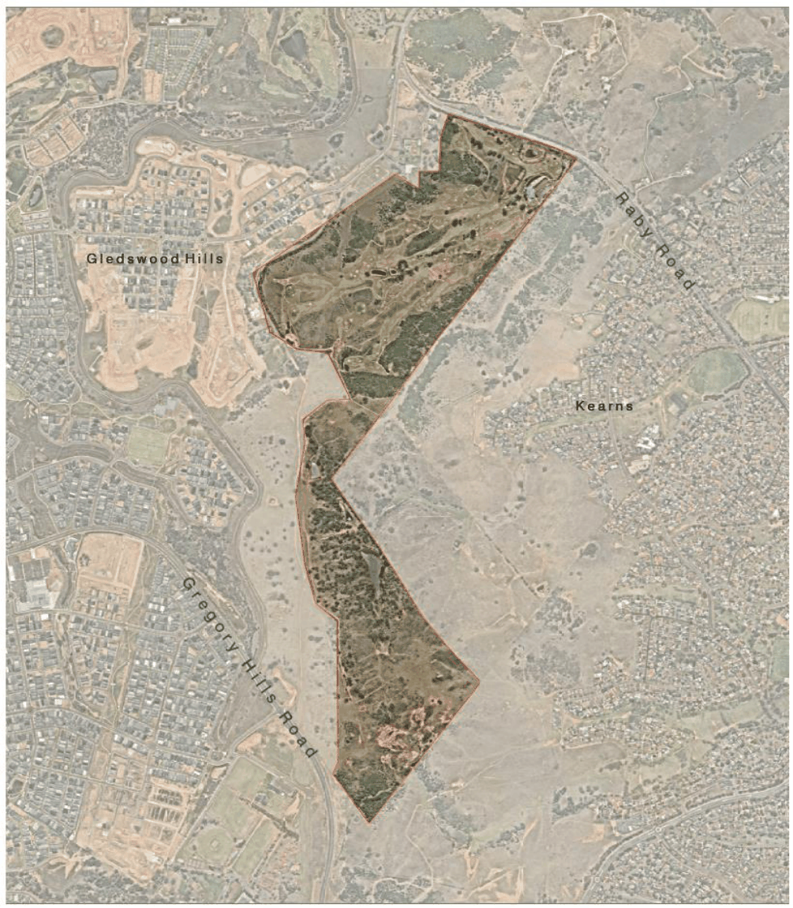

### 19.1 Introduction

#### 19.1.1 Application

This Part sets out controls for land known as the Macarthur Grange Golf Course site being Lot 3900 in

DP1170905 as shown in Figure 1.

> [Picture on page 4: a picture, saved as a picture (images/vol-2-part-19-macarthur-grange-site-specific-development-con-page-4-5.gif, 150 dpi).]

#### Figure 1: Area of application

#### 19.1.2 Purposes of this part

The purpose of this Part is to establish a supplementary planning framework, beyond the general provisions of the Campbelltown (Sustainable City) DCP 2015, for achieving the Council’s endorsed vision for the Macarthur Grange Golf Course site (the site), through the establishment of specific objectives and controls. In doing so it provides a platform against which Council will assess future development applications within the site.

#### 19.1.3 Relationship to other parts of the Campbelltown DCP

The controls applicable to development of land within the site are generally detailed in this Part. When a development control is not specified in this Part, development should be consistent with all other relevant controls of Volume 1 of the Campbelltown (Sustainable City) DCP 2015.

In particular, this Part should be read in conjunction with the following parts of Volume 1 of the Campbelltown (Sustainable City) DCP 2015:

• Part 2 Requirements Applying to All Types of Development

• Part 4 Rural Residential Development and Ancillary Rural Residential Structures

• Part 6 Commercial Development

• Part 14 Parking of Heavy Vehicles on Residential, Rural and Environmental Protection Land Premises. Note: Despite the provisions in Table 14.3.1 of Part 14,  the maximum number of heavy vehicles permissible on allotment may be further restricted in community title subdivisions on land zoned C4 (formerly E4).

The Campbelltown City Council Engineering Design Guide for Development also applies to development specified in this Part.

Where there is an inconsistency between this Part and any other part of the Campbelltown (Sustainable City) DCP 2015, this Part applies to the extent of the inconsistency.
