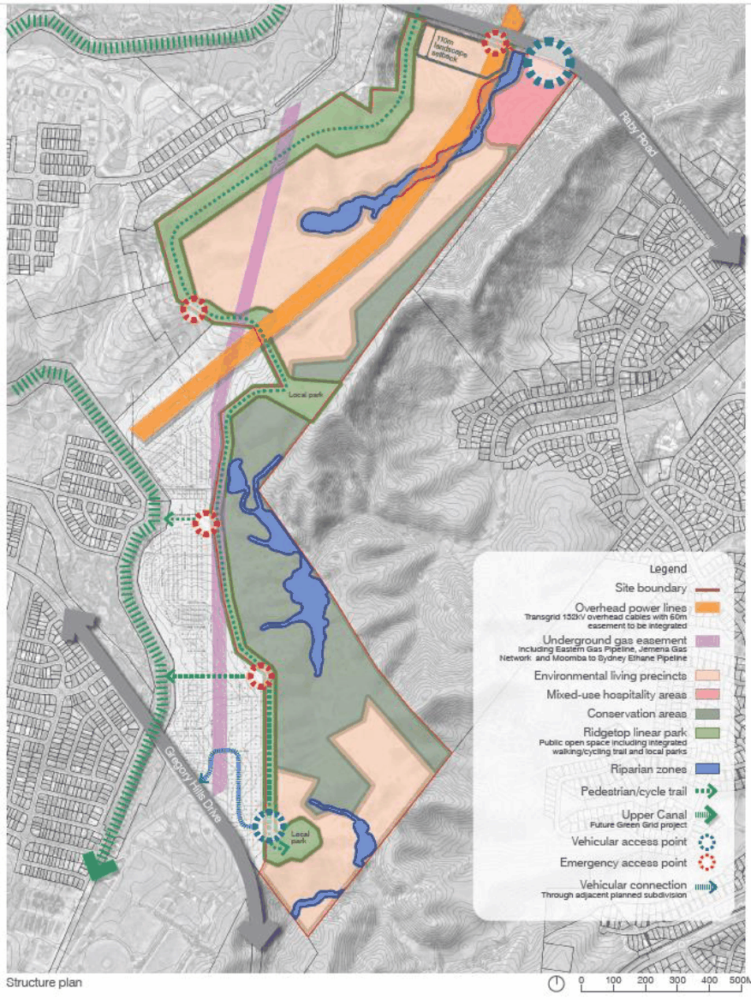

### 19.2 Future character and development objectives

#### 19.2.1 Future character statement

The open rural and bushland landscape character of the site will be largely maintained to protect the qualities of this section of the Scenic Hills Landscape Unit, whilst allowing for limited development. The predominantly rural character will be maintained and further include the retention and rehabilitation of native vegetation with scattered building s that are nestled in the landscape.

Modest, single dwellings will allow the grassy paddocks and native vegetation to dominate views of the site, transitioning seamlessly into adjacent parts of the Scenic Hills. Generous environmental living lot sizes ranging from 0.5ha to 3ha facilitate sensitively landscaped dwelling contexts and ensure ecological protection of the land to maintain its environmental and scenic qualities for the future. Key riparian corridors will be retained and protected through establishment of vegetated buffers to improve water quality and ecological function.

The core values of the Scenic Hills will be retained by providing a layout and built form outcome compatible with the rural and landscape character of the area, whilst delivering a development model which ensures its protection in the long term.

Limited commercial activities will be established on land surrounding the existing Golf Club house building adjacent to Raby Road potentially including a, function centre and/or restaurant / café with the layout and design respecting the scenic qualities of the area.

Public access to this part of the Scenic Hills will be provided through an extensive north-south walking and cycling link with opportunities for future connection to existing cycle paths, potential trails through the adjacent areas of the Scenic Hills and planned Sydney Green Grid projects.  The walking and cycle path will connect riparian open space, local parks at key lookout points, and an extensive Hilltop Conservation Area. The Conservation Area will provide the long-term protection and restoration of high-quality contiguous Cumberland Plain Woodland vegetation.

#### 19.2.2 Development Objectives

1\. To ensure individual lots are distributed to maintain the rural and landscape character and scenic qualities of the Scenic Hills Landscape Unit.

2\. To ensure that subdivision pattern, road layout and buildings respond to the topography and the location of significant vegetation and drainage lines

3\. To ensure buildings are appropriately located within the landscape to protect significant vegetation, facilitate sensitive soft landscaping and minimise visual impacts.

4\. To provide a mix of lot sizes, ranging from 0.5ha to around 3ha, accommodating a diverse environmental / rural residential community.

5\. To provide a road network that facilitates safe, convenient and legible access to the site and is consistent with the rural and landscape character of the area.

6\. To provide for a north-south walking and cycle link through the site connecting to existing cycle paths, potential future trails through the Scenic Hills and wider planned Sydney Green Grid projects with minimum conflicts and maximum safety.

7\. To provide riparian open space and a series of ‘lookout parks’ at key high points in the landscape connected by the walking and cycle path.

8\. To establish a Hilltop Conservation Area to protect and restore the most significant areas of contiguous native vegetation.

9\. To ensure European and Aboriginal cultural heritage is acknowledged and appropriately managed.

10\. To ensure bushfire hazards are appropriately managed, including emergency access.

11\. To retain, rehabilitate, protect and maintain significant riparian corridors, enhance their water quality and ecological function and ensure the maintenance of existing flow regimes.

12\. To ensure existing service infrastructure is not compromised and appropriate service infrastructure is provided in an economic and environmentally sensitive and safe manner.

> [Picture on page 7: a picture, saved as a picture (images/vol-2-part-19-macarthur-grange-site-specific-development-con-page-7-6.gif, 150 dpi).]

#### Figure 2: Structure Plan
