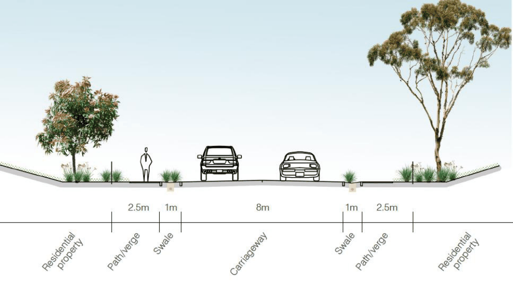
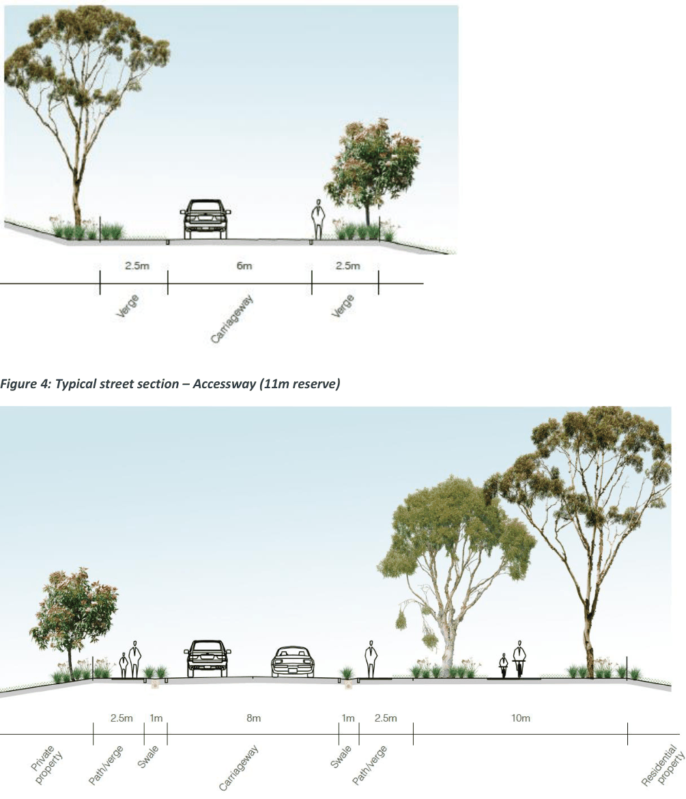

### 19.3 Provisions

#### 19.3.1 General provisions and Master Plan

#### Objectives

To ensure that development is consistent with the Future Character Statement and Development Objectives outlined in Sections Error! Reference source not found. and 19.319.2.2 of this Part.

#### Controls

1\. A master plan shall be prepared in accordance with the Structure Plan at Error! Reference source n ot found. and the objectives and development controls set out in this Part under section 2.2.

2\. Where variation from the structure plan is proposed , the applicant is to demonstrate that the proposed development is consistent with the Vision and Development Objectives set out in Sections Error! Reference source not found. and 19.319.2.2 of this Part.

3\. In addition to the above requirements (3.1.1 and 3.1.2), the preparation of the masterplan shall be informed by:

a. the outcome of consultation with infrastructure providers including Sydney Water,

b. the outcome of consultation with public agencies including but not limited to the Department of Climate Change, Energy, the Environment and Water;

c.  safety and access requirements identified through consultation and compliance with the requirements of public agencies, including, but not limited to, APA (Gas pipelines owner) , Jemena (Gas pipeline owner), Telstra and Endeavor Energy,

d. the outcome of a comprehensive geotechnical investigation to be carried out by the proponent,

e. a comprehensive Water Cycle Management Plan including a stormwater management plan for the entire site.

4\. Building envelopes suitable for a dwelling and ancillary buildings shall be identified for each environmental living lot on the master plan to ensure that the Vision and Development Objectives set out in Sections Error! Reference source not found. and 19.319.2.2 of this Part will be satisfied.

#### 19.3.2 Subdivision

#### Objectives

• To ensure that the subdivision is undertaken as a Neighborhood Scheme, pursuant to the Community Land Development Act 2021 and appropriate management provisions are enacted.

• Ensure that the subdivision pattern responds to the physical characteristics of the land, including landscape setting, topography and landform, significant vegetation, heritage sensitivity and drainage patterns.

• Ensure that future environmental living lots can accommodate a dwelling and associated buildings / structures having regard to the constraints of the land including significant vegetation, topography (including drainage lines), views to and from the land, heritage sensitivity, bushfire hazard, safety measures in relation to gas pipeline easements and asset protection zone requirements.

• Ensure that subdivision and associated development is compatible with the future character statement and scenic and broad ranging environmental values of the Scenic Hills.

• To limit the size, number and distribution of lots across the site to ensure that development maintains an environmental / rural residential character.

• Provide safe connections to the surrounding street network, and pedestrian, cycleways and public open space networks.

• To ensure clarity in respect of management of non-public infrastructure and public infrastructure.

• To facilitate ready and practical access for maintenance of public open space and publicly owned/controlled conservation lands.

#### Controls

1\. Subdivision is to be generally in accordance with the structure plan at Error! Reference source not f

ound. and approved master plan.

2\. The total number of environmental living lots created within the Neighborhood Scheme shall not exceed 52 lots.

3\. Subdivision is not to result in the creation of battleaxe lots.

4\. Subdivision applications are required to demonstrate how safe access (including emergency access) can be provided to the surrounding road network.

5\. Subdivision applications are to be accompanied by a visual impact assessment which demonstrates that the subdivision works, and construction do not result in adverse visual impacts in the context of the Scenic Hills, including its heritage qualities.

6\. All non-public infrastructure in the subdivision shall be provided and managed as part of a neighborhood scheme pursuant to the relevant Community Titles legislation.

7\. A Water Cycle Management Plan (WCMP) for the entire site including impacts on adjoining properties and roads must be prepared and submitted with the subdivision development application on the site.

8\. Future subdivision shall be designed to address any impacts of flooding.

9\. Any environmental living lot that is impacted by the Sydney to Moomba gas pipeline, shall have a lot size of not less than 2 ha.

10\. Building envelopes (suitable for a dwelling and ancillary buildings) consistent with the Master Plan shall be identified for each environmental living lot on the plan of subdivision to ensure that the Vision and Development Objectives set out in Sections Error! Reference source not found. and 19.319.2.2 of this P art will be satisfied.

11\. No buildings or structures shall be erected on land within 110 metres of Raby Road.  This area shall be used for landscaping purposes only to ensure visual protection.

12\. All future developments must comply with the Council’s Engineering Design for Development (as amended), Volume 1, Part 2, 2.10 of the Campbelltown (Sustainable City) DCP and the Western Sydney Engineering Design Guidelines and NSW Rural Fire Service current version of Planning for Bushfire Protection.

13\. Asset Protection Zones, water quality treatments, detention basis/structures etc. should be located outside of the designated riparian corridors and appropriately accommodated within the developable land footprint. Identification of footprints.

14\. The subdivision design shall ensure unrestricted practical access for all maintenance vehicles/equipment seeking to access public open space and publicly owned/controlled conservation lands.

Important Note: There is a potential opportunity, that needs to be explored at the master plan/subdivision stage, to connect to Mayfield Place (currently partially public road) and to provide a through public access road in the Camden LGA.

#### 19.3.3 Earthworks

#### Objectives

• To limit the extent of cut and fill and encourage design of buildings to respond to the existing contours of the land.

• To minimise the visual and physical impact of development (including support infrastructure) and to maintain the scenic and broad ranging environmental values of the Scenic Hills.

• To encourage stepped or inset building forms that blend with and follow the landscape rather than excessive cut and fill.

• To ensure site responsive service infrastructure installation.

#### Controls

1\. For any dwelling or associated building the maximum level of cut shall not exceed 1m below the ground level (existing) and the maximum level of fill shall not exceed 1m above ground level (existing), when measured at any corner of the building platform.

2\. All service infrastructure proposed shall be accompanied by a comprehensive statement of environmental effects that also details minimisation of earthworks impacts and appropriate management

Note: The provisions set out in Volume 1, Section 2.8 Cut Fill and Floor Levels of this DCP shall be complied with.

#### 19.3.4 Built form and design

#### Objective

• To ensure that the building form, design and materials minimise visual impacts, respect prevailing heritage qualities and retain the rural, landscape and scenic character of the Scenic Hills.

#### Controls

1\. Building design and materials are to be consistent with the relevant provisions of Part 4 Rural Residential Development and Ancillary Rural Residential Structures of Volume 1 of the SCDCP.

2\. Dwellings, associated buildings, structures, and car parking areas are to be located within the building envelope identified on the master plan and subdivision plan.

3\.  Development shall comply with the requirements of Part 4 Rural Residential Development and Ancillary Rural Residential Structures of this DCP.

#### 19.3.5 Landscaping and landscaped area

#### Objectives

• To maximise landscaped area and limit the amount of impervious area.

• To maintain the landscape and rural character of the site and ensure consistency with the scenic values and heritage qualities of the Scenic Hills.

#### Controls

1\. A minimum of 50% of the site area shall consist of Landscaped Area, this may include lawn, deep rooted trees, native vegetation, garden beds and mulched areas.

2\. A minimum of 75% of the front setback area shall be Landscaped Area.

3\. Landscaping should be provided in accordance with the requirements of Volume 1, Section 2.5 Landscaping of this DCP.

4\. Development should minimise any impacts on existing native vegetation and prevailing landscape qualities, including through necessary bushfire asset protection zones.

5\. Landscaping and tree planting shall be, where relevant, consistent with the requirements of public agencies requirements relating to tree plantings near public assets.

6\. The area of the site that is within 110 metres of Raby Road shall be used for landscaping purposes only to ensure visual protection.

Note: Landscaped Area is defined in the Campbelltown Local Environmental Plan 2015 as follows:

“a part of a site used for growing plants, grasses and trees, but does not include any building, structure or hard paved area.”

#### 19.3.6 Fencing

#### Objectives

• To ensure that fencing does not adversely impact on the rural and landscape and heritage qualities of the Scenic Hills.

#### Controls

1\. Fencing shall be a maximum height of 1.2m and be of an open style consistent with traditional rural timber and post and rail and/or wire construction.

2\. Fencing shall comply with all other relevant requirements of Part 4 Rural Residential Development and Ancillary Rural Residential Structures of this DCP.

3\. Raby Road frontage shall be the subject of an integrated landscape and fencing treatment in keeping with the high visual quality of the locality.

4\. No fencing shall be of a type that blocks open landscape views (i.e. pre painted profile metal or lapped and capped timber fencing).

#### 19.3.7 Access and circulation

#### Objectives

• Provide a road network that facilitates safe, convenient and legible access to the site

• Provide safe and accessible connections to the existing/proposed road network, including emergency access and egress and access for maintenance.

• Provide a road network that is consistent with the proposed environmental / rural residential character and maintains the scenic and heritage values of the Scenic Hills.

• Provide a north-south pedestrian and cycleway connection through the site which links proposed areas of open space and the bushland reserve and can potentially connect to existing cycleways and wider planned Green Grid projects.

• Limit access from Raby Road to one principal access.

• To minimise the visual impact of driveways and parking areas within individual lots.

#### Controls

1\. The master plan and subdivision plan shall include one principle point of access from Raby Road, a detailed street network, pedestrian and cycle network, and access to the existing/proposed road network. The road network shall be designed in consultation with Council and Transport for NSW.

2\. The intersection with the Raby Road shall be designed and constructed in consultation with Transport for NSW.

3\.  Figures 3, 4 and 5 are provided as examples of street sections that can be accommodated within the subdivision.

4\. The street design and network shall balance access, safety, earthworks, utilities provision, amenity and maintenance.

5\. The collector road servicing the subdivision, accessed from Raby Road, shall be a two way street, designed generally in accordance with the street section shown on Figure 3 below.

6\. All roads shall be constructed to Council’s road design specifications and dedicated to Council. Council’s road design specifications are included in the Council’s Engineering Design for Development (as amended) and the Western Sydney Engineering Design Guidelines.

7\. The design of the local street network is to:

a. Create a safe environment for walking and cycling with safe crossing points,

b. Take into account the site’s topography and view lines to and from the site,

c. Minimise earthworks,

d. Provide frontage to maximise surveillance of open space,

e. Retain existing trees, where appropriate, within the road reserve, and

f. Readily accommodate immediate service infrastructure requirements and facilitate access to higher order infrastructure where required.

8\. The location of access driveways to individual lots should consider the natural features, topography and existing vegetation of the site.

9\. Any roads or driveways that are proposed to impact on public infrastructure shall be designed and located in accordance with the requirements of the relevant public authority (including service providers) who own and/or manage the public infrastructure asset.

10\. Public road access including emergency access must be available to both the northern and southern precincts of the site (refer to Figure 2 Structure Plan) .

11\. Provide safe and accessible connections to the existing road network, including alternative access for emergency services as indicated on Figure 2 Structure Plan.

12\. A secondary emergency access point shall be provided to Raby Road in a safe location.

13\. Any future development application for subdivision to create environmental living lots shall include a plan outlining protocols for emergency vehicle access, with contingency routes in the event that the primary access is compromised.

14\. Any existing rights of carriageway and easements for services within the site shall be incorporated and dealt with appropriately in any subdivision design.

> [Picture on page 13: a picture, saved as a picture (images/vol-2-part-19-macarthur-grange-site-specific-development-con-page-13-14.gif, 150 dpi).]

#### Figure 3: Typical street section – Local Road (15m reserve)

> [Picture on page 14: a picture, saved as a picture (images/vol-2-part-19-macarthur-grange-site-specific-development-con-page-14-1.gif, 150 dpi).]

#### Figure 4: Typical street section – Accessway (11m reserve)

Figure 5: Typical street section – Local Road with pedestrian / cycle green link (15m + 10m reserve)

#### 19.3.8 Provision and Maintenance of Public Infrastructure

#### Objectives

• To ensure that the existing public infrastructure is not compromised by future development, and remains accessible for maintenance by relevant service providers.

• To ensure adequate future public service infrastructure is planned, funded, and provided in a timely manner, meeting the requirements of relevant public agencies and which respects the sensitivities of the site.

• To ensure the safety, functionality, and integrity of electricity infrastructure in all stages of development.

• To support the progressive undergrounding of electricity infrastructure in line with modern urban planning practices.

#### Controls

1\. Development applications for subdivision must include evidence of consultation with the relevant infrastructure providers/agencies and compliance with their requirements including (but not limited to) Jemena, APA, Telstra, Endeavour Energy, and Sydney Water. This evidence must demonstrate adherence to the standards and guidelines of the respective agencies.

2\. Gas Infrastructure

a. An Encroachment Safety Management Study (ESMS) in relation to the existing high-pressure gas line (Currently owned/managed by Jemena) must be prepared by a qualified professional and submitted to Council as part of the development application for subdivision. This study must involve engagement with Jemena and APA to ensure safety and compliance.

3\.  Water, Wastewater, and Trade Waste Services

a. The development application for the subdivision must include sufficient information/studies demonstrating compliance with Sydney Water’s requirements for servicing the development.

b. The provision of reticulated water and wastewater must be supported by a detailed technical analysis, assessing the capacity of the relevant network including hydraulic modeling if required. All studies must be prepared in consultation with Sydney Water.

Note: Where the proposed development is anticipated to generate trade wastewater, the applicant must submit an application requesting permission to discharge trade wastewater to Sydney Water’s wastewater system.  The applicant must wait for the issue of a permit before any business activities can commence.
