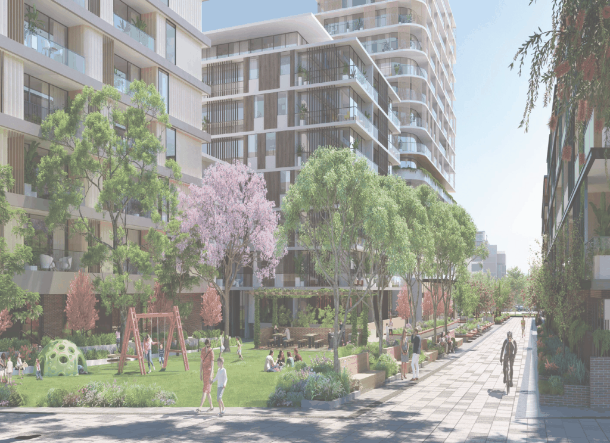

## 34 Queen Street, Campbelltown

## 34 Queen Street, Campbelltown

### Development Control Plan - Volume 2 – Part 20

### Development Control Plan - Volume 2 – Part 20

#### Adopted: 9 September 2025

#### Adopted: 9 September 2025

#### Effective: 31 November 2025

#### Effective: 31 November 2025

#### Adopted: 9 September 2025

#### Effective: 6 February 2026

> [Picture on page 1: a picture, saved as a picture (images/vol-2-part-20-34-queen-street-development-control-plan-page-1-11.gif, 150 dpi).]

#### Prepared by FPD Planning

#### Amendment by Campbelltown City Council
