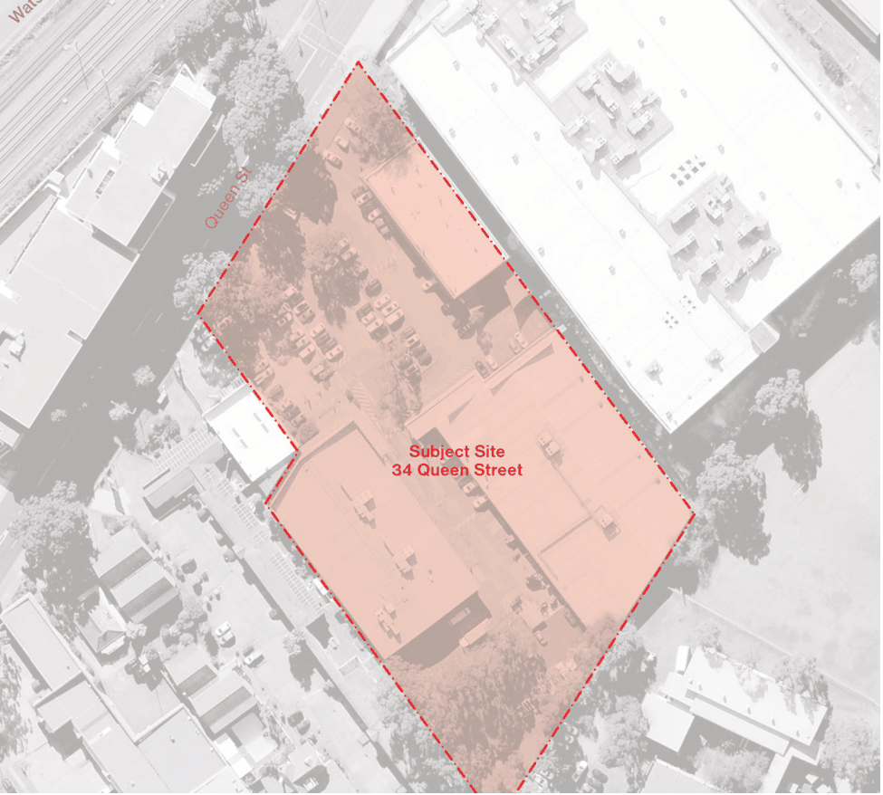

### 20 .1 Application

#### 20.1.1 Land to which this part applies

This Development Control Plan (DCP) applies to land at 34 Queen Street, Campbelltown, being

the land identified in Figure 20.1 below. The subject site comprises 1 lot and is known legally

as Lot 1 in DP 604549.

The land is situated at the northern end of Campbelltown CBD on Queen Street. The site

adjoins a large redevelopment site at 22-32 Queen Street, the Maclin Lodge Motel (and for­

mer Congregational Manse) at 38 Queen Street.  Further north of the site, at 12-19 and 18-20

Queen Street is the State heritage listed Leumeah Barn (Warby’s Barn) and Warby’s Stable.

Queen Street is characterised by a mix of uses including high density residential, medial and

commercial uses. To the rear of the site is the Campbelltown Performing Arts High School.

The site is well served by public transport being within 800m of the Campbelltown train sta­

tion and close to high frequency bus services on Queen Street in front of the site.

> [Picture on page 3: a picture, saved as a picture (images/vol-2-part-20-34-queen-street-development-control-plan-page-3-14.gif, 150 dpi).]

#### Figure 20.1 – Land to which this part applies – 34 Queen Street
