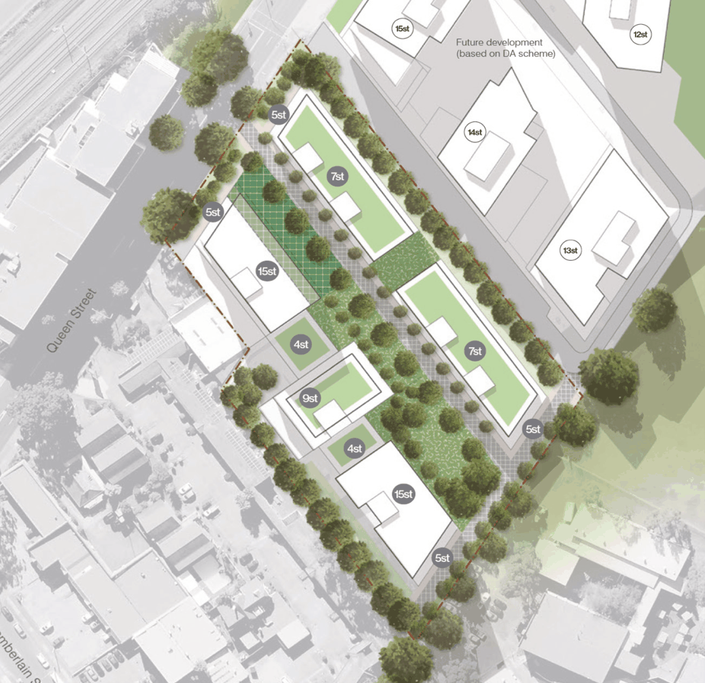

### 20 .2 Vision and Development Objectives Cont.

> [Picture on page 6: a picture, saved as a picture (images/vol-2-part-20-34-queen-street-development-control-plan-page-6-2.gif, 150 dpi).]

#### Figure 20.2 – 34 Queen Street Masterplan
