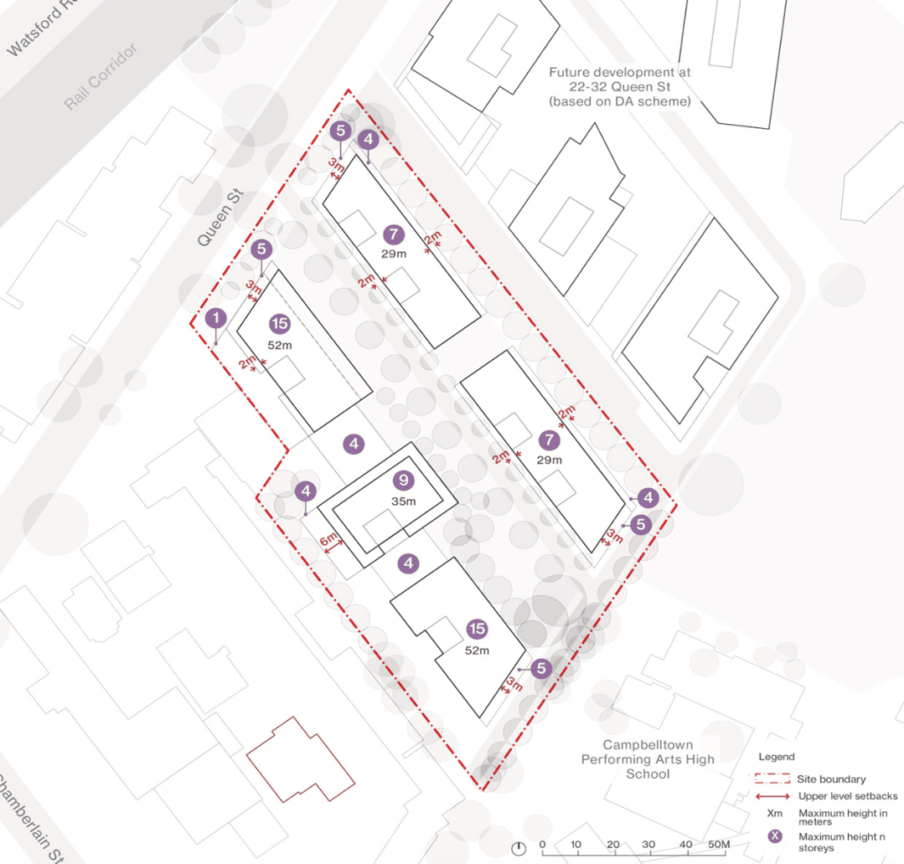

### 20 .3 Development Objectives and Controls

#### 20.3.1 Built form and layout

#### Objectives

•	 To create a high-quality mixed-use development that promotes the renewal of the site through

well-designed buildings and spaces.

•	 To ensure buildings are designed and oriented to maximise solar access to communal open

spaces and minimise overshadowing to neighbouring properties.

•	 To concentrate mixed use buildings and ground floor non-residential uses close to Queen

Street to activate the street and enhance the public domain.

•	 To deliver high-quality built form that provides excellent resident amenity.

#### Controls

1\.	 Provide a range of building heights, generally in accordance with Figure 20.3, to create a diver­

sity of heights and interest across the site.

2\.	 Taller buildings are to be designed and oriented to maximise solar access and residential amen­

ity and minimise overshadowing.

3\.	 Lower scale buildings should be located to the north to maximise solar access and deliver a

high level of amenity for communal open space and ground floor uses.

4\.	 Provide upper-level setbacks in accordance with Figure 20.3 to ensure buildings provide a tran­

sition and appropriately scaled interface to adjoining properties and the public domain.

5\.	 Buildings should address Queen Street to activate the street frontage and create a high-quality

interface to Queen Street.

6\.	 Encourage ground floor apartments and residential entries on buildings at the rear of the site

to enhance residential activation and address ground floor communal open space.

> [Picture on page 8: a picture, saved as a picture (images/vol-2-part-20-34-queen-street-development-control-plan-page-8-1.gif, 150 dpi).]

#### Figure 20.3 – 34 Queen Street - Building layout and heights in storeys
