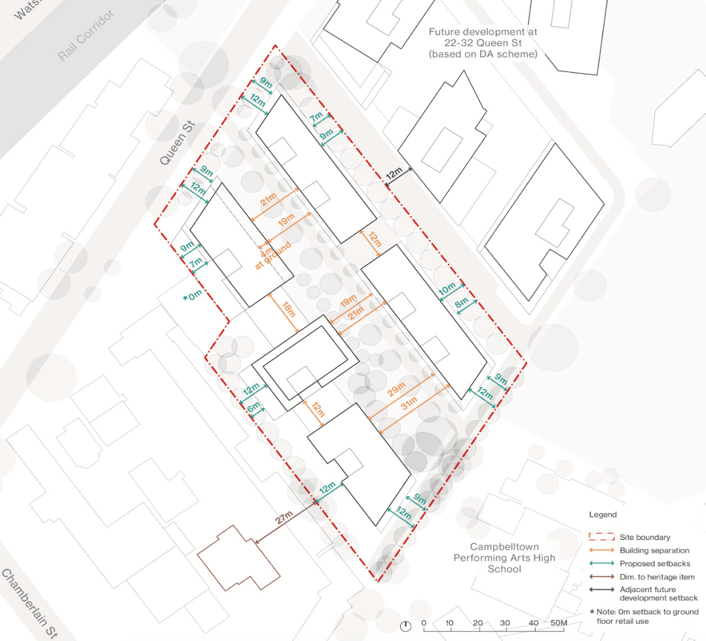
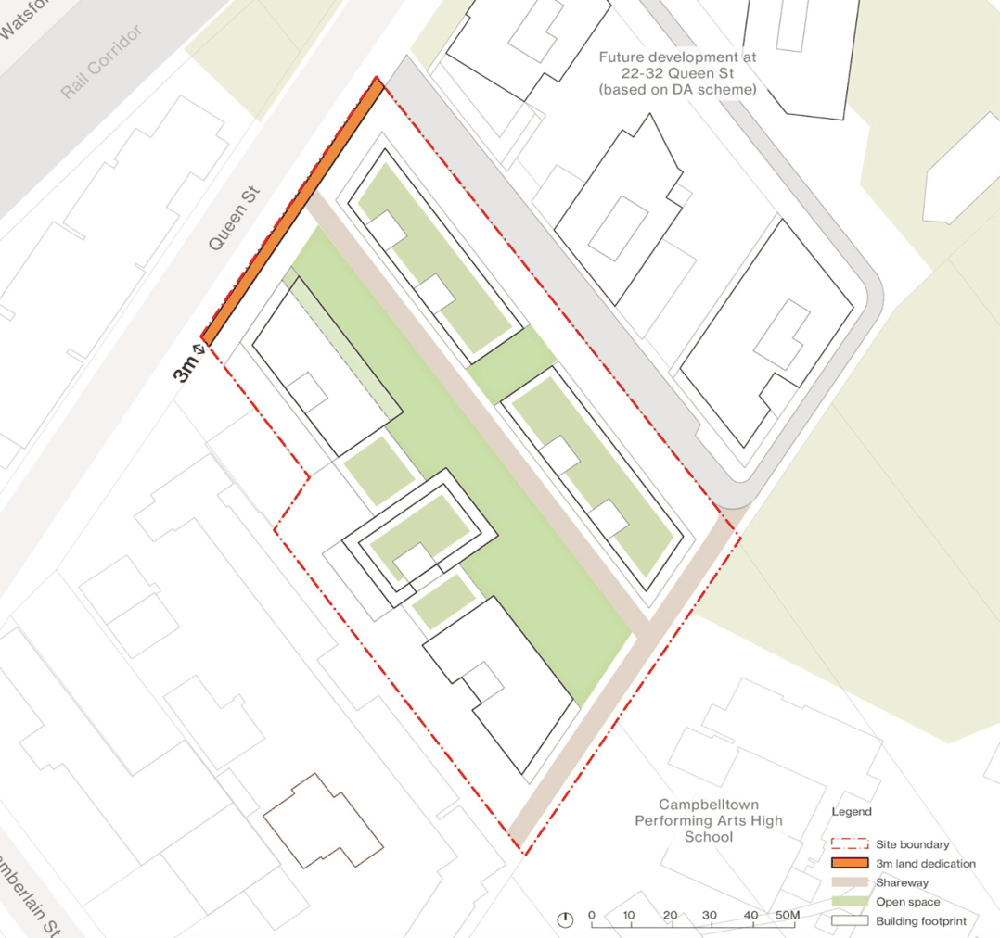

#### 20.3.2 Building separation and setbacks

#### Objectives

•	 To provide appropriate scaled buildings and lower street wall heights to adjoining buildings and

the public domain.

•	 To reinforce Queen Street and activate the public domain through lower street wall heights and

generous setbacks to Queen Street.

•	 To ensure buildings provide an appropriate street interface to Queen Street and communal

open space.

•	 To utilise building separation to create outlook, green space and views through the site.

•	 To ensure setbacks provide for deep soil, landscaping, and greening opportunities

#### Controls

1\.	 Building setbacks should generally be provided in accordance Figure 20.4.

2\.	 Dedicate a minimum of 3m of land fronting Queen Street to Council in accordance with Figure

20.5.

3\.	 Provide a minimum 9m landscaped front setback to Queen Street (inclusive of the 3m land ded­

ication).

4\.	 Provide a minimum 12m landscaped setback from the southern and eastern boundaries of the

site to ensure an appropriate setback and generous buffer between surrounding buildings and

the heritage item to the south.

5\.	 All ground level setbacks are to be landscaped to provide a buffer to adjoining properties and

enhance amenity within the site.

6\.	 Building separation to be in accordance with the Apartment Design Guide and generally in ac­

cordance with Figure 20.4.

> [Picture on page 10: a picture, saved as a picture (images/vol-2-part-20-34-queen-street-development-control-plan-page-10-1.gif, 150 dpi).]

#### Figure 20.4 – Building separation and setback

> [Picture on page 11: a picture, saved as a picture (images/vol-2-part-20-34-queen-street-development-control-plan-page-11-1.gif, 150 dpi).]

#### Figure 20.5 – Land dedication plan
