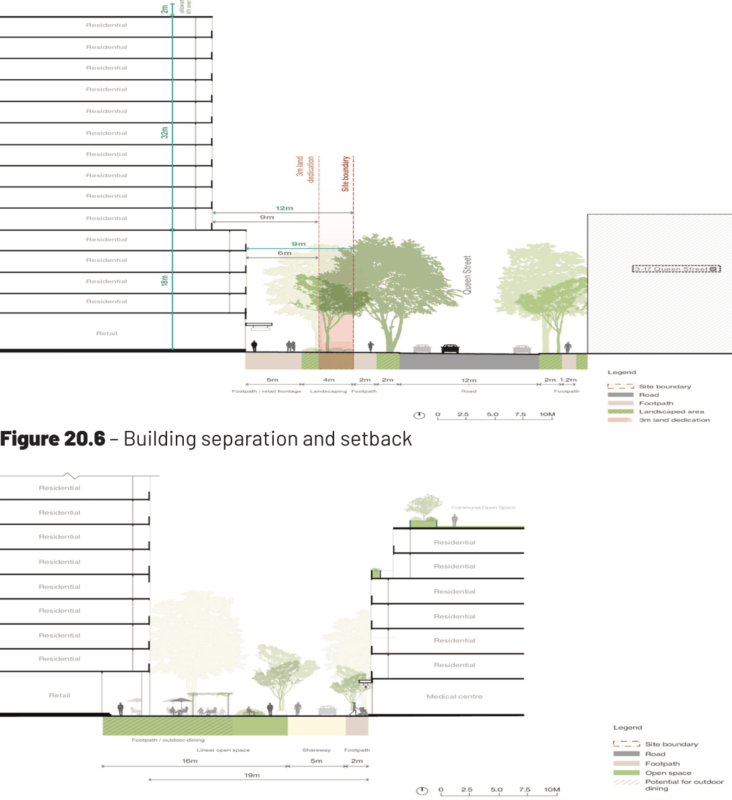

#### 20.3.3 Queen Street Interface and activation

#### Objectives

•	 To revitalise and activate Queen Street with high levels of amenity and an enhanced public

domain.

•	 To provide ground floor retail uses, enhanced landscaped setbacks, and appropriately scaled

built form to define Queen Street.

•	 To create a pedestrian friendly Queen Street and public domain, with enhanced landscaping,

street trees and outdoor dining.

•	 To improve ground floor activation and connections from Queen Street through the site.

#### Controls

1\.	 Building setbacks to Queen Street should be provided in accordance with Figure 20.6 below,

including:

• A minimum front setback and podium setback of 9 metres, comprising:

• a minimum 5m paved footpath to encourage outdoor dining and improved walking

connections along Queen Street.

• a minimum 4m front landscaped setback to retain existing high value street trees and

enhance landscaping along the frontage of the site.

• A minimum tower setback of 12 metres.

2\.	 The podium height should not exceed 5 storeys (18m).

3\.	 Provide a minimum 5 metre floor to floor height at ground level to provide for amenity and ad­

aptability for future non-residential uses.

4\.	 Buildings are to have an active frontage at ground level and address both Queen Street and the

internal laneway/ open space to encourage activation at ground level into the site (in accord­

ance with Figure 20.7).

> [Picture on page 13: a picture, saved as a picture (images/vol-2-part-20-34-queen-street-development-control-plan-page-13-1.gif, 150 dpi).]

#### Figure 20.6 – Building separation and setback

#### Figure 20.7 – Building separation and setback
