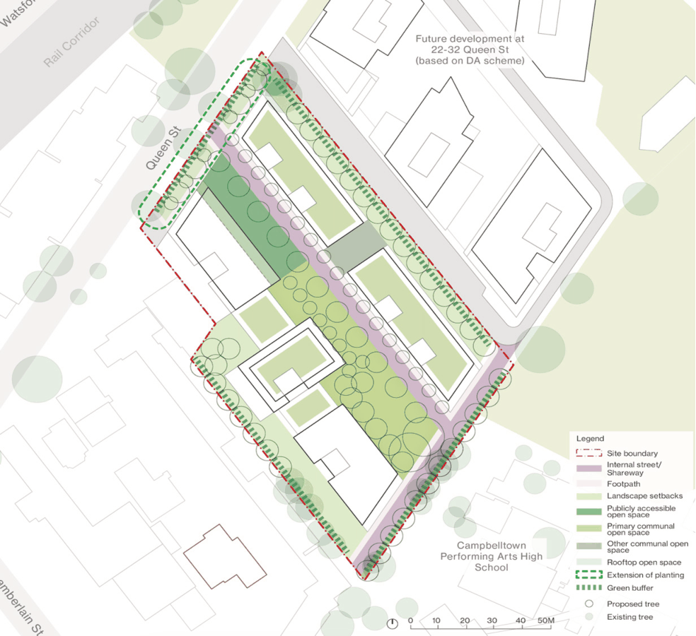
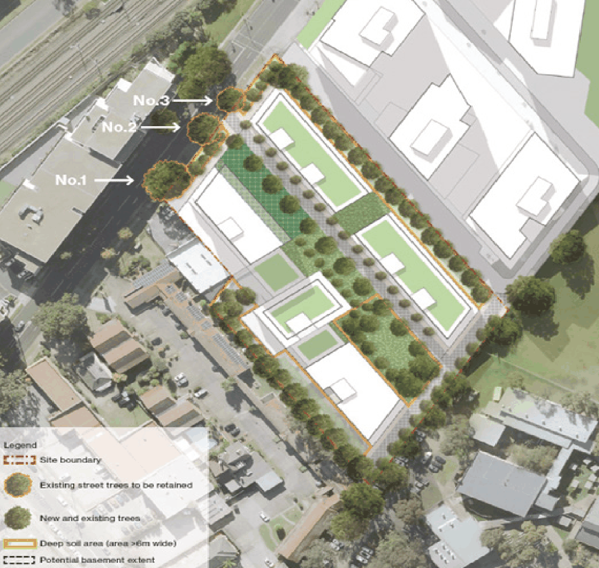

#### 20.3.4 Landscaping, publicly accessible open space and

### communal open space

#### Objectives

•	 To provide generous linear open space to activate Queen Street, improve connections through

the site and provide clear access and address for buildings.

•	 To ensure open space provides for a variety of functions and users, including residents, work­

ers, and visitors.

•	 To ensure open space is designed to provide activation and visual interest while ensuring resi­

dential amenity, safety, and privacy.

•	 To activate the length of communal open space through retail uses and ground floor residential

entries to increase useability and passive surveillance.

•	 To promote generous landscaping in setbacks and in communal open space areas.

•	 To retain high value street trees and deliver improved landscaping and tree canopy across the

site.

#### Controls

#### Landscaping

1\.	 Development should generally be consistent with the indicative landscaping plan shown in Fig­

ure 20.8, except where it can be demonstrated that improved outcomes can be achieved.

2\.	 Through site connections (including pedestrian and vehicle laneways) are to be integrated into

the landscaping design to improve useability and safety for all users.

3\.	 Retain high value trees along Queen Street in accordance with Figure 20.9 and retain existing

matures trees within setbacks where possible.

4\.	 Provide sufficient deep soil to deliver a minimum 30% tree canopy on the site and allow for ma­

ture tree plantings in the side and rear setbacks.

5\.	 A minimum of 19% deep soil is to be provided on site in accordance with the design guidance

for large sites in the Apartment Design Guide. An indicative deep soil plan is provided at 20.9

which demonstrates one way deep soil could be achieved on the site.

6\.	 Where an engineering solution to address flooding incorporates a swale, proposed tree plant­

ing within the dedicated swale must be undertaken in consultation with a qualified landscape

architect and approved by Council’s Flood/Stormwater Engineer (or equivalent). Planting must

ensure that stormwater can be conveyed through the site with minimal obstruction.

#### Publicly accessible open space

7\.	 Development should generally be consistent with the indicative publicly accessible open space

shown in Figure 20.8, except where it can be demonstrated that improved outcomes can be

achieved.

8\.	 A detailed plan is to be prepared and submitted to Council that illustrates the function and role

of the publicly accessible open space on site and how this space will be designed and managed.

9\.	 Public access should be provided to open space at the front of the site to activate Queen Street

and support ground floor retail uses.

#### Communal open space

10\.	Communal open space should deliver a range of functions including activation and vibrancy for

ground floor retail uses and privacy and amenity for residents.

11\.	 Ensure sufficient private communal open space and amenity is provided to meet the needs of

residents.

12\.	Ground floor communal open space should be complemented with roof top communal spaces

to provide outlook and rooftop greening.

13\.	 Communal open space is to be provided in accordance with the Apartment Design Guide.

> [Picture on page 15: a picture, saved as a picture (images/vol-2-part-20-34-queen-street-development-control-plan-page-15-9.gif, 150 dpi).]

Figure 20.8 – Indicative landscaping, publicly accessible open space and

#### communal open space layout

> [Picture on page 16: a picture, saved as a picture (images/vol-2-part-20-34-queen-street-development-control-plan-page-16-1.gif, 150 dpi).]

#### Figure 20.9 – Indicative deep soil areas and tree rentention
