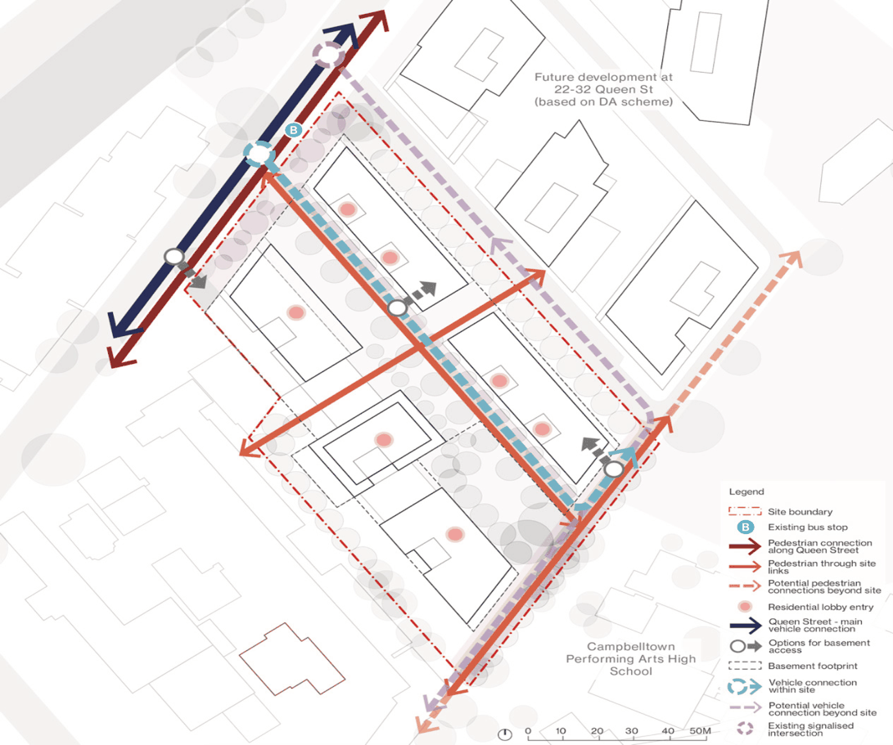

#### 20.3.5 Access and movement

#### Objectives

•	 To create a pedestrian focused movement network through the site.

•	 To allow for low vehicle movements through the site to provide improved access and surveil­

lance.

•	 To provide improved access through the site and allow for future connections to adjoining

sites.

•	 To promote walking and cycling for local trips with new connections and an enhanced public

domain.

•	 To identify preferred access locations for basement entry and servicing to minimise conflicts

with pedestrians and promote activation and amenity within the site.

•	 To minimise the number of entries and vehicle crossing points on Queen Street

•	 To ensure the design and function of the internal laneway and through site

#### Controls

1\.	 New connections and vehicle access should be generally consistent with the indicative layout

in Figure 20.10, subject to detailed design requirements.

2\.	 Car parking is to be provided in accordance with the rates in Part 5 of the CSCDCP 2015 and is to

be provided below ground.

3\.	 A limited number of above ground car parking spaces for non-residential uses may be consid­

ered, but only where the design of the spaces is integrated with the landscaping plan and does

not impact access, landscaping or public domain outcomes.

4\.	 A detailed plan is to be prepared and submitted to Council that outlines how the internal lan­

eway will be designed to ensure safety and functionality for all users. This plan should outline

any requirements for pedestrian crossings and safety measures to minimise potential conflicts

between vehicles and pedestrians.

5\.	 New streets and pedestrian connections are to be activated with ground floor non-residential

uses and ground floor apartments or residential entries.

6\.	 New streets and connections should be designed to include access points that allow for future

connections to adjoining sites.

7\.	 The access and movement network for the site is to provide improved connections along Queen

Street and integrate with the existing bus stop on Queen Street.

> [Picture on page 18: a picture, saved as a picture (images/vol-2-part-20-34-queen-street-development-control-plan-page-18-1.gif, 150 dpi).]

#### Figure 20.10 – Indicative deep soil areas and tree rentention
