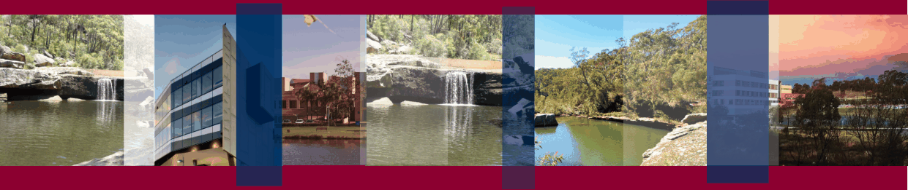
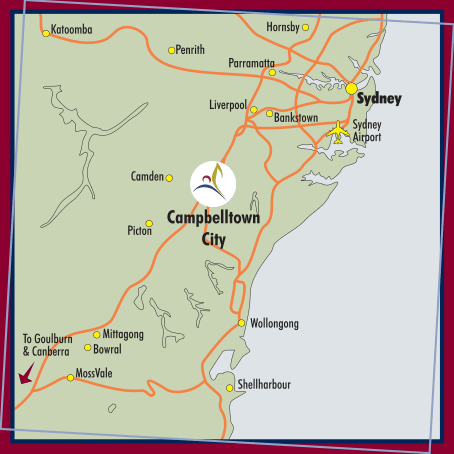

# Campbelltown Sustainable City Development Control Plan 2015 - Front Cover

Source PDF: [covervolume3.pdf](https://planfortomorrow.sharepoint.com/sites/Planfortomorrow/Shared%20Documents/00%20NSW-Planning-Resources/dcp/campbelltown-sustainable-city-development-control-plan-2015/vol-3-front-cover/covervolume3.pdf)

### Campbelltown (Sustainable City) Development Control Plan 2015

> [Picture on page 1: a picture, saved as a picture (images/vol-3-front-cover-page-1-5.gif, 150 dpi).]

### VOLUME 3

### Deferred Areas DCP

### Creating Campbelltown's Future 2025

> [Picture on page 2: a picture, saved as a picture (images/vol-3-front-cover-page-2-1.gif, 150 dpi).]

campbelltown.nsw.gov.au

Campbelltown City Council, PO Box 57, Campbelltown, NSW 2560
