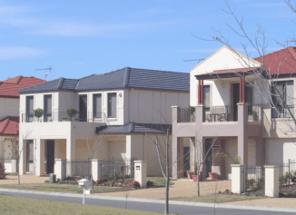

### 2.2 Building Form and Character

#### Building Form &

#### Character

Building form and character refers to the collective result of a number of different elements of building design and siting, that when combined make up the appearance and feel of the ‘built environment’. Through good quality design, the character of a neighbourhood can be enhanced.

#### Objectives:

■

■Ensure that the massing and scale of new development are complementary to the existing and desired residential buildings in the neighbourhood.

■

■Maintain a low-medium density spatial character within existing neighbourhoods.

■

■Ensure that buildings are designed to enhance the existing and future desired built form and character of the neighbourhood by encouraging innovative and quality designs that fit harmoniously with their surroundings.

■

■Ensure that parking areas, garages and driveways are appropriately sited, designed and constructed so that they do not detract from the appearance of the development or the streetscape.

■

■Ensure the provision of equitable access to natural light and ventilation for the

> [Picture on page 3: a picture, saved as a picture (images/vol-3-part-02-residential-and-ancillary-development-page-3-25.gif, 150 dpi).]

occupants of all residential buildings.
