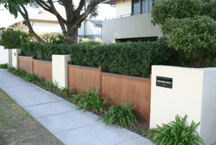

#### 2.2.3  Fencing

#### Design Requirements

a)	 Bonded sheet metal fencing shall not be constructed at any location other than along side and rear boundaries shared with other private property, where such fencing is not highly visible from the street, public reserve or other public place, unless the site is within a bushfire prone area.

b)	 Urban land residential fencing along

> [Picture on page 4: a picture, saved as a picture (images/vol-3-part-02-residential-and-ancillary-development-page-4-36.gif, 150 dpi).]

Figure 2.2.2 - Example of a part masonry/part timber fence that helps to define private space and adds interest to the character of the streetscape.

the rear and side boundaries shall be:

i)	 located behind the primary street dwelling setback;

ii)	 a maximum 2.1 metres in height (excluding retaining walls); and

iii)	a maximum 1.8 metres in height, if adjoining a secondary street.

c)	 Front residential fencing shall be

a maximum of 1.2 metres in height and complement the design of the development.

#### Building Form &

d)	 Fencing on corner allotments shall not

#### Character

obstruct the sight distance of traffic entering or within an intersection or roundabout.

e)	 Fencing shall not obstruct power, water, sewer, gas or telephone services, drainage systems, (including overland flow paths) or any easements or rights of way.

f) Details for fencing shall be submitted with the development application.
