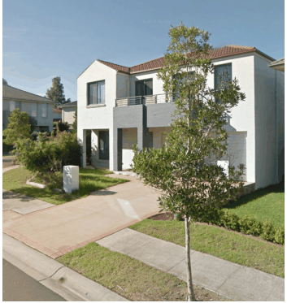
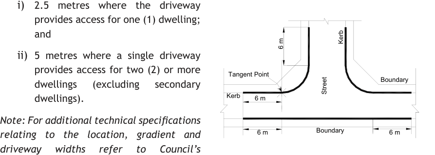

### 2.3 Car Parking and Access

#### Car Parking &

#### Access

#### Objectives:

■

■ Provide adequate on-site car parking for residents and visitors that is convenient, secure and safe having regard to the traffic generated by the development.

■

■ Ensure efficient and safe vehicle and pedestrian movement within, into and out of development.

■

■ Ensure that the location and design of driveways, parking, service areas and access areas are practical, easily maintained, convenient, safe and suitably landscaped.

■

■ Provide safe convenient access for vehicles, pedestrians and cyclists whilst

> [Picture on page 6: a picture, saved as a picture (images/vol-3-part-02-residential-and-ancillary-development-page-6-17.gif, 150 dpi).]

minimising conflict between them.

#### Design Requirements

a)	 The minimum dimensions of any required parking space shall be 2.5 metres x 5.5 metres. If the car parking space adjoins a 100mm vertical edge, the minimum width shall be 2.7 metres.

b)	 The minimum internal dimension of an enclosed garage shall be 3 x 6 metres.

c)	 Transitional grades shall comply with AS2890.1 (as amended) Parking Facilities - Off-Street Car Parking.

d)	 The maximum garage floor levels

Figure 2.3.1 Example of a driveway that is of appropriate width and located perpendicular to the road.

(above or below) for a garage setback

6.0 metres from the front property boundary  shall be in accordance  the requirements contained under Council’s Engineering Guide for Development, (Appendix K - Standards Drawings No SD-R08, which is available at Council’s website at www.campbelltown.nsw. gov.au.

e)	 Driveways greater than 30 metres in length as viewed from the street shall be avoided.

f) Driveways shall be located a minimum distance of 6 metres from the tangent point of any unsignalled intersection (refer to Figure 2.3.2).

Note: In circumstances where an intersection

#### Car Parking &

is controlled by lights, a roundabout or the like, applicants are requested to contact Council for specific requirements.

#### Access

g)	 The minimum width of the driveway at the street kerb shall be:

> [Picture on page 7: a map, saved as a picture (images/vol-3-part-02-residential-and-ancillary-development-page-7-8.gif, 150 dpi); the street names and other small labels are on the picture.]
> Words printed on the picture (title and legend, copied from the PDF):
> i)	 2.5 metres where the driveway
> ii)	 5 metres where a single driveway

provides access for one (1) dwelling; and

provides access for two (2) or more dwellings (excluding secondary dwellings).

Note: For additional technical specifications relating to the location, gradient and driveway widths refer to Council’s Engineering Guide for Development available at Council’s website at www. campbeltown.nsw.gov.au

Figure 2.3.2 – Restricted locations of driveways entry as shown  heavy edged lines.

h)	 For residential developments incorporating more than 50 dwellings, a Traffic Impact Assessment Report shall be prepared by a suitably qualified person and submitted with the development application.

#### Note:

Note: For requirements relating to the preparation of a Traffic Impact Assessment Report refer to Appendix 12.

i) Driveways shall be designed and located perpendicular to the road.

Council will not be liable to replace any driveway colour or pattern within public land in cases where damage to private driveways as a result of maintenance work undertaken by Council has occurred.

j) Plain concrete driveways including cross over and layback shall not be permitted. Details of driveway colours and pattern shall be submitted with the development application.
