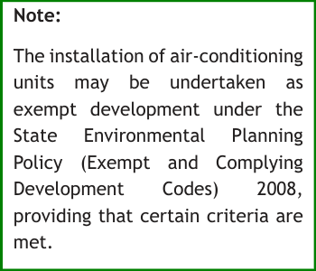

#### 2.4.1 Acoustic Privacy

#### Design Requirements

a)	 Development that adjoins significant

#### Note:

Development Near Rail Corridors and Busy Roads – Interim Guideline provides a useful guide for all development that may be impacted by rail corridors or busy roads .

> [Picture on page 8: a picture, saved as a picture (images/vol-3-part-02-residential-and-ancillary-development-page-8-18.gif, 150 dpi).]

noise sources, (such as main roads, commercial/industrial development, public transport interchanges and railways) shall be designed to achieve acceptable internal noise levels, based on recognised Australian Standards and any criteria and standards regulated by a relevant State Government Authority.

b)	 Development shall incorporate noise attenuation measures that are compatible with the scale form and character of the street.

#### Note:

The installation of air-conditioning units may be undertaken as exempt development under the State Environmental Planning Policy (Exempt and Complying Development Codes) 2008, providing that certain criteria are met.

c)	 On-site noise generating sources including, but not limited to, plant rooms and equipment, air conditioning units, pool pumps, and recreation areas shall be designed and located to ensure that the noise levels generated by such facilities do not exceed 5dBa above background levels at the property boundary.

d)	 Multi dwellings and narrow lot dwellings near railway lines and major roads shall demonstrate to Council’s satisfaction compliance with the requirements under the Guidelines entitled Development Near Rail Corridors and Busy Roads – Interim Guideline, 2008)

Note: This Guide is available for view/ download from the Department of Planning and Environment website at: www.planning. nsw.gov.au.

Note: Applicants are encouraged to refer to the Office of Environment and Heritage Environmental Criteria for Road Traffic

Noise.
