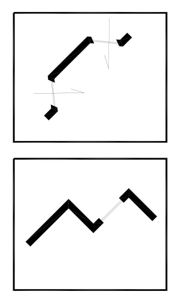

#### 2.4.2 Visual Privacy

#### Acoustic &

#### Visual Privacy

#### Design Requirements

a)	 No window of a habitable room or balcony shall directly face a window of another habitable room, balcony or private open space of another dwelling located within 6 metres of the proposed window or balcony unless appropriately screened (refer to Figure 2.4.1).

b)	 Notwithstanding 2.4.2(a) any window of a living room located on an upper level shall:

i)	 be offset by 2 metres to limit views between windows and balconies; or

ii)	 have a sill height 1.7 metres above the floor level; or

iii)	be splayed to avoid direct views between windows; or

iv)	have fixed translucent glazing in any part of the window within 1.7 metres of the floor level.

c)	 Notwithstanding 2.4.2(a), a balcony will

> [Picture on page 9: a picture, saved as a picture (images/vol-3-part-02-residential-and-ancillary-development-page-9-27.gif, 150 dpi).]

Figure 2.4.1– Illustration of a method to offset windows to avoid potential privacy conflict.

be considered where the private open space area of any adjacent dwelling is screened from view.

d)	 No wall of a proposed building shall be permitted to be constructed on the boundary for that portion of the boundary that is directly adjacent to an existing required private open space area on the adjoining allotment.

e)	 With any development application involving the construction of a building wall on a boundary, the creation of an easement for access and maintenance on the adjoining land may be required.
