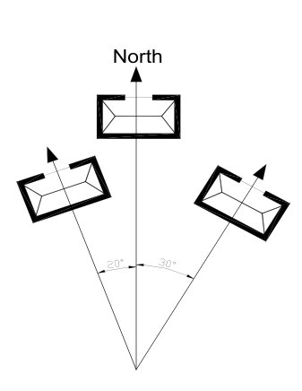

### 2.5 Solar Access & Energy Efficiency

#### Solar Access &

#### Energy Efficiency

Good design based on efficient use of renewable natural resources can maximise the thermal comfort and energy efficiency of dwellings. This can be achieved by reducing unwanted winds and draughts whilst optimising natural ventilation as well as maximising use of natural light for heating, lighting and clothes drying purposes.

#### Objectives:

■

■ Encourage building design and siting to take advantage of climatic factors and reduce household energy consumption.

■

■ Encourage features to be incorporated into site and building design to optimise

> [Picture on page 10: a picture, saved as a picture (images/vol-3-part-02-residential-and-ancillary-development-page-10-15.gif, 150 dpi).]
> Words printed on the picture (title and legend, copied from the PDF):
> North

passive solar access to internal and external spaces.

#### Design Requirements

a)	 Living areas shall generally have a northerly orientation.

b)	 A minimum 20sqm fixed area of the required private open space shall receive three (3)  hours of continuous direct solar access on  21 June, between 9.00am and 3.00pm, when measured at ground level.

c)	 Development shall have appropriate regard to the impact on solar access to useable private open space and living areas, solar collectors and clothes drying areas of adjoining residential development.

Figure 2.5.1 – Desirable range of window orientation for north facing windows.

d)	 Building siting shall take into consideration the range of factors that impact on solar access including slope of land, vegetation and existing building and other structures.

Note: Council may  consider the use of deciduous trees at the north and west elevations to protect against hot summer temperature and to allow for solar penetration in winter, where it may otherwise be inappropriate to plant native trees.
