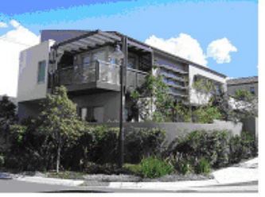

### 2.6 Dwelling Houses, Domestic Outbuildings, Swimming Pools/Spas.

#### and Secondary dwellings

#### Dwelling

This section only applies to dwelling houses, domestic outbuildings, swimming pools/ spas and secondary dwellings.

Houses,

#### Domestic

Outbuildings,

#### Objectives:

#### Swimming

#### Pools/Spas &

■

■ Encourage quality-designed dwelling houses, secondary dwellings and domestic outbuildings that make a positive contribution to the streetscape and amenity

> [Picture on page 11: a picture, saved as a picture (images/vol-3-part-02-residential-and-ancillary-development-page-11-16.gif, 150 dpi).]

of the neighbourhood.

#### Secondary

#### dwellings
