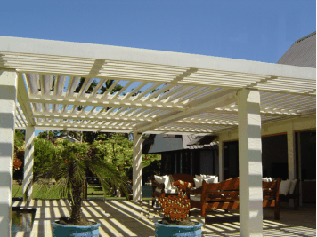

#### 2.6.2 Dwelling Houses

#### 2.6.2.1 Minimum Site  Requirements

a)	 A dwelling house  shall not be erected on land with an area of less than 500 square metres and average width of not less than 15 metres (measured at the primary building setback) unless the allotment was in existence at the date upon which the Plan came into effect.

#### 2.6.2.2  Setbacks

a)	 A dwelling house shall be setback a minimum of:

i)	 5.5 metres from the primary street boundary for the dwelling;

#### Dwelling

ii)	 6.0 metres from the primary street

Houses,

boundary for the garage;

#### Domestic

#### Outbuildings, iii)	3 metres from the secondary

street boundary;

iv)	5.5 metres from the secondary street

#### Swimming

#### Pools/Spas

Gross floor area means the sum of the floor area of each floor of a building measured from the internal face of external walls, or from the internal face of walls separating the building from any other building, measured at a height of 1.4 metres above the floor, and includes:

#### &

i)	 the area of a mezzanine;

boundary for the garage, where the garage is accessed directly from the secondary street;

and

#### Secondary

#### dwellings

v)	 0.9 metres from any side boundary; and

ii)	 habitable rooms in a basement or an attic; and

vi)	3 metres from the rear boundary for iii)	any shop, auditorium,

cinema, and the like, in a basement or attic;

any part of the building that is up to 4.5 metres in height from ground level (existing); and

but excludes:

vii)	8 metres from the rear boundary for

i)	 any area for common vertical circulation, such as lifts and stairs, and

any part of the building that is higher than 4.5 metres from ground level (existing).

ii)	 any basement:

#### 2.6.2.3  Car Parking Rates

–– storage, and

a)	 A dwelling house shall be provided

–– vehicular access, loading

with a minimum of one undercover car parking space.

areas, garbage and services, and

#### 2.6.2.4  Private Open Space

iii)	plant rooms, lift towers

a)	 A dwelling house shall be provided with an area of private open space that:

and other areas used exclusively for mechanical services or ducting, and

i)	 is located behind the primary building setback;

iv)	car parking to meet any

ii)	 has a minimum area of 75sqm;

iii)	has a minimum width of 3 metres;

requirements of the consent authority (including access to that car parking), and

iv)	includes a minimum levelled area of

v)	 any space used for the

(5x5)sqm;

v)	 has a minimum of unfragmented area of 60sqm;

loading or unloading of goods (including access to it), and

vi)	has an internal living room directly accessible to outdoor private open space areas; and

vi)	terraces and balconies with outer walls less than

1.4 metres high, and

vii)	satisfies solar access requirements vii)	voids above a floor at the

level of a storey or storey above.

contained in  section 3.6.

#### Dwelling

Note: For sloping sites, Council may consider the provision of a minimum 2 metre x 8 metre balcony as part of the required private open space as satisfying the requirements of Clause 2.6.2.4 a) v).

Houses,

#### Domestic

Outbuildings,

#### 2.6.2.5  Waste Bin Requirements

#### Swimming

#### Pools/Spas

a)	 Space shall be allocated behind the

#### & Secondary

primary and secondary building lines and out of public view to store the following:

#### dwellings

i)	 a 140 litre bin; and

ii)	 two (2) 240 litre bins.

> [Picture on page 13: a picture, saved as a picture (images/vol-3-part-02-residential-and-ancillary-development-page-13-23.gif, 150 dpi).]

Figure 2.6.2 – An example of a pergola with a zero setback the rear boundary.
