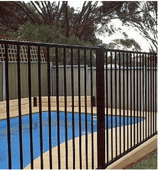

#### 2.6.4 Swimming  Pools/Spas

#### 2.6.4.1  General Requirements

a)	 Safety fencing for swimming pools/spas shall comply with the Swimming Pools Act 1992, Swimming Pools Regulation 2008 and the Australian Standard 1926

- 2007 - Swimming Pool Safety (As amended).

#### 2.6.4.2  Setbacks

a)	 Swimming pools/spas shall be located behind the front primary building setback.

b)	 Swimming pools/spas that do not incorporate decking/coping greater than 600mm above natural ground level at any point shall be setback a minimum of:

i)	 1 metre from the rear and side boundaries; and

ii)	 1 metre from the secondary boundary(corner allotments).

#### Dwelling

Houses,

#### Domestic

Outbuildings,

#### Swimming

#### Pools/Spas

c)	 The setback requirements under Clause 2.6.4.2 b) shall be inclusive of any decking/coping associated with the pool.(i.e. the minimum 1 metre setback shall be calculated from the edge of the decking/coping to the side boundary, rear or secondary boundary).

#### &

d)	 Swimming pools/spas that incorporate

#### Secondary

#### dwellings

decking /coping greater than 600mm above natural ground level at any point shall  be setback a minimum of:

i)	 5.5 metres  from the primary street boundary;

ii)	 3 metres from the secondary street boundary;

iii)	1.5 metres from the side and rear boundaries.

> [Picture on page 15: a picture, saved as a picture (images/vol-3-part-02-residential-and-ancillary-development-page-15-29.gif, 150 dpi).]

Figure 2.6.3 – Illustration of a fenced pool.

e)	 Adequate measures shall be implemented to ensure the amenity (noise/privacy)  of adjoining neighbours is maintained.

f) The pool pump/filter shall be located as far away as practicable from neighbouring dwellings and shall be enclosed in an acoustic enclosure to minimise noise impacts on adjoining properties.
