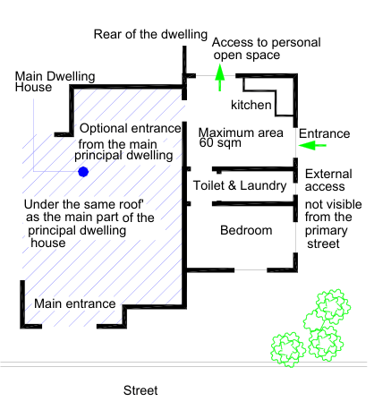

#### 2.6.5 Secondary Dwellings

#### 2.6.5.1  General Requirements

a)	 A secondary dwelling shall incorporate similar or complementary design and construction features, finishes, materials and colours to those of the principal dwelling house.

b)	 A secondary dwelling shall be designed to ensure that the entry door to the secondary dwelling is not visible from the street or other public place.

c)	 A BASIX certificate shall accompany a development application for a garden flat.

d)	 An attached secondary dwelling shall

#### Dwelling

be located under the same roof as the main part of the principal dwelling house.

#### 2.6.5.2  Maximum floor area

Houses,

#### Domestic

Outbuildings,

a)	 A secondary dwelling shall not exceed 60sqm in gross floor area.

#### Swimming

#### Pools/Spas

#### 2.6.5.3 Setbacks

#### &

a)	 A secondary dwelling land shall be setback a minimum of:

#### Secondary

#### dwellings

i)	 5.5 metres from the primary street boundary of the dwelling;

ii)	 3 metres from the secondary street boundary;

iii)	0.9 metres from any side boundary; and

iv)	3 metres from the rear boundary for

> [Picture on page 16: a map, saved as a picture (images/vol-3-part-02-residential-and-ancillary-development-page-16-27.gif, 150 dpi); the street names and other small labels are on the picture.]
> Words printed on the picture (title and legend, copied from the PDF):
> Rear of the dwelling
> Access to personal
> Maximum area Entrance
> from the main
> Toilet & Laundry
> Under the same roof'
> as the main part

Figure 2.6.4 – Illustration of an attached secondary dwelling

any part of the building that is up to 3.8 metres in height from ground level (existing); and

v)	 8 metres from the rear boundary for any part of the building that is higher than 3.8 metres from ground level (existing).

#### 2.6.5.4 Maximum Height

a)	 A secondary dwelling shall not exceed two storeys in height.

Note: Nothing in this Plan shall be taken to mean that a secondary dwelling can be subdivided  from  the principle dwelling on the allotment  unless such a subdivision is consistent with relevant development standards within the relevant EPI.

#### Multi Dwellings
