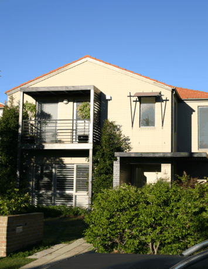

### 2.7 Multi Dwellings

#### Important Note:  For the purpose of the DADCP, multi dwelling include “dual

occupancy”, “dual occupancy (attached)”, “integrated housing development” and “multi dwellings” as defined under Campbelltown (Urban Area) Local

#### Environmental Plan 2002.

#### Objective:

■

■ Encourage quality designed multi dwellings that makes a positive contribution

> [Picture on page 17: a picture, saved as a picture (images/vol-3-part-02-residential-and-ancillary-development-page-17-10.gif, 150 dpi).]

to the streetscape and amenity of the neighbourhood.
