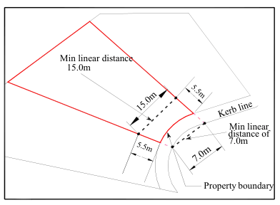
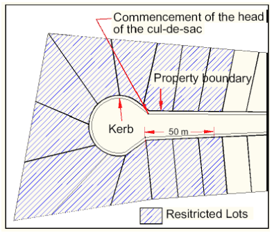
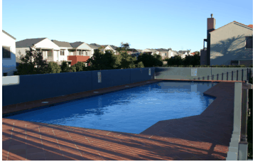
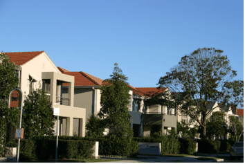

#### 2.7.1 Site and Density Requirements for Multi Dwellings

#### Design Requirements

a)	 Multi dwellings shall not be erected on land with an area of less than 700sqm.

b)	 Multi dwellings shall not be erected on an existing battle-axe allotment.

c)	 Subject to the satisfaction of other requirements within the Plan, the number of dwellings permitted within a multi dwelling development shall not exceed:

i)	 2 dwellings for the first 	700sqm of land area; and

ii)	 1 dwelling for each 300sqm of  land area thereafter.

d)	 For the purpose of calculating the developable area of an allotment:

i)	 any land that is  part of an environmental corridor as specified by the Office of Environment and Heritage or any other government agency; or

ii)	 any land that is subject to bushfire,

Figure 2.7.1 An example of a multi dwelling development, with street frontage.

flooding or other risk (excluding mine subsidence); or

iii)	a right of carriage way; shall not be included within the developable area of the allotment, unless the relevant public agency

is satisfied that that part of the allotment is capable of being developed for the purpose of multi dwellings.

#### Multi

#### Dwellings

e)	 Multi dwellings incorporating 2 dwellings shall only be permitted on a site having;

i)	 a minimum width of 15 metres measured along the side boundaries at a distance of 5.5 metres from the primary street boundary; and

> [Picture on page 18: a map, saved as a picture (images/vol-3-part-02-residential-and-ancillary-development-page-18-14.gif, 150 dpi); the street names and other small labels are on the picture.]
> Words printed on the picture (title and legend, copied from the PDF):
> Min linear distance

ii)	 a minimum width of 7 metres Figure 2.7.2 – Illustration of the

requirements for the minimum  allotment frontage incorporating 2  mutli dwellings.

> [Picture on page 18: a picture, saved as a picture (images/vol-3-part-02-residential-and-ancillary-development-page-18-18.gif, 150 dpi).]

measured between the extended property side boundaries, or in the case of a corner allotment, the secondary street boundaries where they intersect with the kerb line.

f) Multi dwellings incorporating 3 or more dwellings shall only be permitted on an site:

i)	 having a minimum width of 22.5 metres measured along the side boundaries at a distance  of 5.5 metres from the primary street boundary;

ii)	 having a minimum width of 10 metres  measured between the extended property side boundaries, or in the case of a corner allotment, the secondary street boundaries where they intersect with the kerb line; and

iii)	where no part of the allotment

Figure 2.7.3 – Illustration of the 50 metre distance from the commencement of the head of a cul-de-sac where multi houses development incorporating 3 or more dwellings are restricted.

is within 50 metres of the commencement of the head of a cul-de-sac to which vehicular access  to the site is obtained (refer to Figure 2.7.3).

g)	 The total FSR shall not exceed 0.45:1.

h)	 A multi dwelling development shall be set back a minimum of:

i)	 5.5 metres from the primary street boundary;

ii)	 3 metres from the secondary

street boundary;

iii)	0.9 metres from any side boundary for the ground level;

#### Multi

#### Dwellings

iv)	1.5 metres from any side boundary for all levels above the ground level;

v)	 5 metres from the rear boundary for the ground level;  and

vi)	10 metres from the rear boundary for all levels above ground level.

i) Notwithstanding  2.7.1(h), any garage shall be setback a minimum of 6 metres from any street boundary.

> [Picture on page 19: a picture, saved as a picture (images/vol-3-part-02-residential-and-ancillary-development-page-19-16.gif, 150 dpi).]

Figure 2.7.4 – Example of communal facilities for a multi dwellings development.

> [Picture on page 19: a picture, saved as a picture (images/vol-3-part-02-residential-and-ancillary-development-page-19-20.gif, 150 dpi).]
