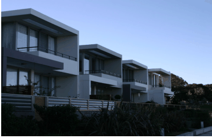
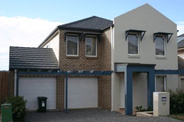

#### 2.7.2 General Requirements for Multi Dwellings

#### Design Requirements

a)	 A minimum of 10% of the total number of dwellings within a multi dwelling development containing 10 or more dwellings shall be adaptable dwelling(s).

b)	 Each multi dwelling unit shall be provided with a minimum of one single garage.

c)	 One (1) external additional visitor car

Figure 2.7.5 – Example of multi dwellings streetscape.

parking space shall be provided for every two (2) units (or part thereof), unless all dwellings within the development have direct frontage to a public street.

d)	 No visitor car parking space shall be located forward of the primary or secondary street boundary.

e)	 No visitor car parking space shall be in a ‘stacked’ configuration.

f) Where a multi dwelling  development involves the retention of an existing dwelling, the  existing dwelling  shall be renovated to match the colour, material, texture and architectural style of the proposed building so as to create a harmonious development.

g)	 The total floor area occupied by all

#### Multi

#### dwellings

bedrooms (and/or rooms capable of being used as a bedroom and wardrobes) within each dwelling shall not exceed 40% of the gross floor area of that dwelling.

h)	 Each  multi dwelling unit shall be provided with an area or areas  of private open space that:

i)	 are not located within the primary street setback;

ii)	 have a minimum area of 60sqm,

> [Picture on page 20: a picture, saved as a picture (images/vol-3-part-02-residential-and-ancillary-development-page-20-14.gif, 150 dpi).]

iii)	have a minimum width of 3 metres; Figure 2.7.6 – Example of high quality

façade treatment for multi dwellings.

iv)	include a minimum levelled area of (5x5)sqm;

v)	 have an internal living room directly accessible to outdoor private open space areas; and

vi)	satisfy solar access requirements contained in  section 3.6.

Note: For sloping sites, Council may consider the provision of a minimum 2 metre x 8 metre balcony as part of the required private open space as satisfying the requirements of Clause 2.7.2.h) v).

i) No part of an outdoor living area is permitted to be located within the primary or secondary street setback area.

j) Any communal open space or recreation              facility provided as a part of a development shall be designed and constructed to:

i)	 ensure safe access by the occupants of the development;

ii)	 prevent access by members of the public; and

iii)	provide for the safety and well being of children in accordance with any applicable Australian Standard.

k)	 Multi dwellings shall satisfy the following additional provisions relating to streetscape:

#### Multi

#### Dwellings

i)	 architectural features (such as balconies, openings, columns, porches, colours, materials  etc) and articulation in walls are  to be incorporated into the front facade of each dwelling;

ii)	 no more than 30% of the area forward of any building line shall be surfaced with impervious  materials.

l) Multi dwellings shall satisfy the following requirements relating to landscape:

i)	 a detailed landscape  design plan

Note: Refer to Section 2.5 Landscaping of Part 2 of Volume 1 of the Plan  for additional requirements on Landscaping.

> [Picture on page 21: a picture, saved as a picture (images/vol-3-part-02-residential-and-ancillary-development-page-21-20.gif, 150 dpi).]

shall be submitted by a suitably qualified person with the development application; and

ii)	 a minimum of 20% of the total site area shall be available for deep soil planting.

m)	 Multi  dwellings  shall  satisfy the following architectural requirements:

i)	 	a distinctive architectural  outcome

Figure 2.7.7 – Example of architecturally designed multi dwellings.

that unifies the range of building elements and diversity  within the development and which also harmonises with surrounding development;

ii)	 incorporation of variations in roof heights and wall planes to   avoid long unbroken ridge lines;

iii)	incorporation of facade shifts and articulation, varied materials and colours in order to avoid duplication of the same building elements; and

iv)	provision of windows and    active spaces in the building  ends, to provide additional security and visual interest.

n)	 Multi dwellings shall not incorporate vehicular access that utilises any gate structure /mechanism other than access to basement car parking.

o)	 Where the development involves the

#### Multi

#### dwellings

retention of an existing dwelling, the existing dwelling  shall be renovated to match the colour, material, texture and architectural style of the proposed building so as to create a harmonious development.
