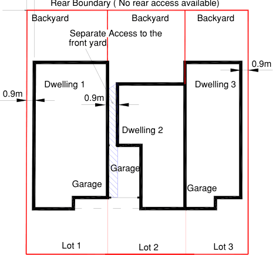

#### 2.7.3  The Size of Indoor Living Areas

a)	 The indoor living areas (i.e family room and lounges) within a multi dwelling unit shall have a minimum of one unfragmented area that is not less than:

i)	 (3x3)sqm in case of a multi dwelling unit with 1 bedroom;

ii)	 (3.5x4)sqm square metres in case of a multi dwelling unit with 2 or 3 bedrooms;

iii)	(4x5)sqm in case of a multi dwelling unit with 4 or more bedrooms.

b)	 For the purpose of this clause, the

> [Picture on page 22: a picture, saved as a picture (images/vol-3-part-02-residential-and-ancillary-development-page-22-23.gif, 150 dpi).]
> [Picture text on page 22 is stored in the PDF without readable letters (no character map), so it could not be copied; see the original PDF.]

Figure 2.7.8– Illustration of an example of a design solution for  ‘rear to front’ access requirement.

total number of bedrooms within a multi dwelling unit shall include any room that is capable of being used as a bedroom.
