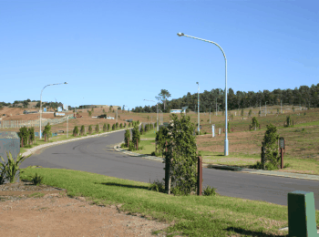

#### 2.8.1 General Requirements

#### Design Requirements

a)	 Subdivision shall have appropriate regard to orientation, slope, aspect and solar access.

b)	 Subdivision design shall comply with the requirements specified in Council’s Engineering Design Guide  for Development, available from Council’s website at www.campbelltown.nsw. gov.au.

c)	 Where relevant, roads shall be designed to provide a satisfactory level of services for the evacuation of occupants in the event of emergency.

d)	 Subdivision shall promote through street access and minimise the number of cul-de-sacs.

e)	 Roads/access handles shall be provided

to separate allotments from any park, reserve, waterway and the like.

#### Residential

#### Subdivision

f) All allotments within a subdivision that are located adjacent to the intersection of local public roads (existing or proposed) shall provide a splay in accordance with Council’s Engineering Design Guide for Development (available from Council’s website at www.campbelltown.nsw.gov.au) to ensure adequate sight distances and maintain footpath widths.

Note: All splays shall be dedicated to Council at no cost to Council.

Note: In the case of an RMS road the size of the splay shall be in accordance with the RMS’s requirements.

g)	 Residential subdivision shall be designed to address the public domain.

> [Picture on page 27: a picture, saved as a picture (images/vol-3-part-02-residential-and-ancillary-development-page-27-22.gif, 150 dpi).]

Figure 2.8.1 – Example of Greenfield residential subdivision

h)	 Wherever possible, subdivision design shall avoid the creation of allotments that have rear boundaries (and fencing) that adjoin the public domain.

i) For the purpose of calculating the minimum allotment size and dimensions under this Plan, any land that is  part of an environmental corridor as specified by the Office of Environment and Heritage or any other government agency shall not be included within the calculated area of land unless the relevant public agency  is satisfied that that part of the allotment is capable of being developed.

j) For the purpose of calculating the minimum  allotment size  and  dimensions under this Plan, any land that is subject to bushfire, flooding or other risk (excluding mine subsidence) shall not be included within the calculated area of land unless it is demonstrated to Council’s satisfaction that the site can be appropriately managed in a manner that retains the ability to be developed for the purpose to which it is intended

under the zone.

k)	 Access to residential subdivisions shall

#### Residential

#### Subdivision

not be permitted to any classified road where alternative access can be made available via the non–classified road network.
