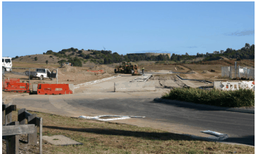

#### 2.8.2 Residential Torrens Title Subdivision-Conventional Allotments

#### Design Requirements

a)	 Any residential conventional allotment created by Torrens Title subdivision shall satisfy the following standards:

i)	 a minimum area of 500sqm;

ii)	 a minimum width of 15 metres

> [Picture on page 28: a picture, saved as a picture (images/vol-3-part-02-residential-and-ancillary-development-page-28-17.gif, 150 dpi).]

Figure 2.8.2 – Example of residential subdivision under construction.

measured along the side boundaries at a distance of 5.5 metres from the front property boundary;

iii)	a minimum width of 7 metres measured between the extended property side boundaries where they intersect with the kerb line; and

iv)	a minimum depth of 25 metres.

b)	 Any  battle axe shaped allotment created by subdivision shall satisfy the following standards:

i)	 a minimum area of 500sqm  excluding the area of the access handle;

ii)	 a minimum depth of 25 metres excluding the length of the access handle;

iii)	no more than one allotment shall be accessed via a battle axe handle;

iv)	a minimum access handle width of

3.5 metres;

v)	 a maximum access handle length of 35 metres;

vi)	no encroachment/s or right of carriage way shall impinge into land within the access handle;

vii)	the provision of an adequately dimensioned vehicle manoeuvring

area, located behind the access handle; and

viii)	the provision of a minimum 0.5

#### Residential

#### Subdivision

metre wide landscape strip along the length of the access handle, where it adjoins the boundary/fence of the neighbouring property.
