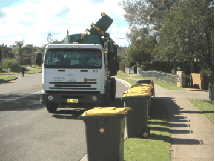

#### 2.8.3 Subdivision of Multi  Dwelling Housing

#### Design Requirements

a)	 For the purposes of the subdivision of multi dwellings incorporating 2 dwellings (being the only dwellings in the development), each allotment to be created shall be part of a Strata Title scheme.

b)	 Despite 2.8.3 a) Council will consider a development application for Torrens Title subdivision of  2 multi dwellings (being the only dwellings in the development) if each allotment satisfies the following standards:

i)	 a minimum area of 300sqm (excluding any access handle);

ii)	 all allotments have  access to a public street;

iii)	at least 1 allotment has direct frontage to a public street;

iv)	a minimum access handle width of

3.5 metres for the servicing of the rear allotment (if proposed); and

v)	 where a battleaxe allotment is created, no right of carriage way shall be created over other allotments.

Note: Nothing in sub clause 2.8.3(a) shall be taken to mean that multi dwellings are permissible on an allotment having an area of less than 700sqm.

c)	 For the purposes of the subdivision of multi dwellings incorporating more than 2 dwellings, all allotments to be created shall be part of a Strata Title scheme.

d)	 Despite 2.8.3 c) Council will consider

#### Residential

#### Subdivision

a development application for Torrens Title subdivision of  3 or more multi dwellings, if each allotment satisfies the following standards:

i)	 a minimum area of 300sqm;

ii)	 a minimum depth of 25 metres;

iii)	all allotments/dwellings within the development have direct frontage to a public street;

iv)	no common property is created;

v)	 a minimum width of 7 metres measured between the extended property side boundaries where they intersect with the kerb line; and

> [Picture on page 30: a picture, saved as a picture (images/vol-3-part-02-residential-and-ancillary-development-page-30-18.gif, 150 dpi).]

Figure 2.8.3     – Residential subdivision allowing adequate accessibility for waste collection vehicles.

vi)	no battle axe allotments are created. Note: For the purpose of clause 2.8.3 d) iii), an access handle does not constitute direct frontage to a public street.

e)	 All required visitors car parking spaces within a Strata Title subdivision shall be within common property.
