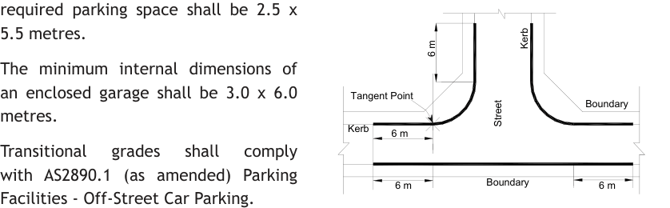

### 3.3 Car Parking and Access - Non-Urban Land

#### Car Parking

#### Objectives:

and

#### Access

#### Non-Urban

■

■ Ensure efficient and safe vehicle and pedestrian movement within, into and out of development.

#### Land

■

■ Ensure that the location and design of driveways, parking, service areas and access areas are practical, easily maintained, convenient, safe and suitably landscaped.

#### Design Requirements

a)	 The minimum  dimensions  of any

> [Picture on page 6: a picture, saved as a picture (images/vol-3-part-03-residential-development-on-non-urban-land-page-6-17.gif, 150 dpi).]
> Words printed on the picture (title and legend, copied from the PDF):
> Kerb
> 6 m
> b)	 The minimum internal dimensions of
> Tangent Point
> Boundary
> Street
> Kerb 6 m
> 6 m
> 6 m
> Boundary
> c)	 Transitional grades shall comply

required parking space shall be 2.5 x

5.5 metres.

an enclosed garage shall be 3.0 x 6.0 metres.

with AS2890.1 (as amended) Parking Facilities - Off-Street Car Parking.

d)	 Driveways shall meet the following criteria:

Figure 3.3 – Inappropriate locations of a driveway entry as shown  by heavy edged lines.

i)	 constructed to a standard that allows for all weather access;

ii)	 designed and located to follow contours to avoid excessive site works, erosion and sedimentation run off;

iii)	have a minimum width of 2.5 metres and a maximum width of 5.0 metres;

iv)	allow for entry to and exit from the property in a forward direction;

v)	 located to minimise the impact on vegetation and the removal of mature trees; and

vi)	one (1) driveway access is permitted per property, in addition to any access required by the NSW Rural Fire Service, where relevant.

e)	 Driveways shall be located a minimum distance of 6 metres from the tangent point of any unsignalised intersection (refer to Figure 3.3).

#### Car Parking

f) Driveways shall be designed and constructed so that they do not divert stormwater from the adjoining road onto the property.

and

#### Access

#### Non-Urban

#### Land

Note: In circumstances where an intersection is controlled by traffic signals, a roundabout or the like, applicants are requested to contact Council for specific requirements.

Note: For additional technical specifications relating to the location, gradient and driveway widths refer Council’s Engineering Design for Development available from Council’s website at: www.campbelltown. nsw.gov.au
