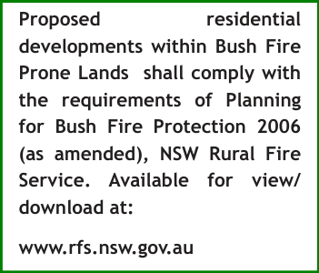

### 3.4 Dwelling Houses, Rural Worker’s Dwelling, Rural Dual Occupancy

#### and Domestic Outbuildings on Non-Urban Land.

#### Dwelling

Houses,

#### Rural Worker’s

This section applies to dwelling houses, rural worker’s dwellings, rural dual occupancy, and  domestic outbuildings located within non-urban land.

Dwelling,

#### Rural Dual

Occupancy and

#### Objectives:

#### Domestic

#### Outbuildings

#### on Non Urban

#### Land

■

■ Encourage quality-designed dwelling houses, rural worker’s dwellings, rural dual occupancy and domestic outbuildings on non-urban land that make a positive contribution to the streetscape and character of the neighbourhood.

#### 3.4.1 Dwelling Houses

a)	 Only one dwelling house shall be permitted per allotment, providing that the allotment meets the minimum standards specified within the relevant planning instrument that applies to that land subject of the development application.

b)	 The minimum setbacks for a  dwelling

Important Note: Despite any other provision of the DADCP, rural developments within Bush Fire Prone Lands must comply with the setbacks requirements under Planning for Bush Fire Protection 2006, NSW Rural Fire Services   (as amended).  Refer to Section 2.14.3 of Volume 1 of the Plan.

house shall be in accordance with the setback requirements for dwelling houses shown in Table 3.4.1.

#### 3.4.2 Rural Worker’s Dwelling

a)	 A rural worker’s dwelling shall only be permitted  where the  relevant planning instrument that applies to the land subject of the development application allows for this type of development to occur.

b)	 Only one rural worker’s dwelling  shall be permitted per allotment, providing that the allotment meets the minimum standards specified within the relevant planning instrument that applies to the land subject to the development application.

c)	 A rural worker’s dwelling shall not exceed 120 sqm in gross floor area.

d)	 A rural worker’s dwelling shall have the same road access as the principal dwelling.

e)	 An application for a rural worker’s

#### Dwelling

Houses,

#### Rural Worker’s

dwelling shall demonstrate to Council that the rural worker’s dwelling shall be occupied by an employee of the farm or a contractor.

Dwelling,

#### Rural Dual

Occupancy and

f) The minimum setbacks for a rural worker’s dwelling  shall be in accordance with the setbacks requirements shown in Table 3.4.2.

#### Domestic

#### Outbuildings

#### on Non Urban

#### 3.4.3 Rural Dual Occupancy

#### Land

a)	 A rural dual occupancy development

Note: For Provision of Services (water, electricity and waste water treatment requirements), refer to Section 2.16 Provision of Services under Volume 1 Part 2 of the Plan.

> [Picture on page 9: a picture, saved as a picture (images/vol-3-part-03-residential-development-on-non-urban-land-page-9-28.gif, 150 dpi).]

shall only be permitted  where the relevant environmental planning instrument that applies to the land, subject of the development application, allows for this type of development to occur.

b)	 Only one rural dual occupancy development  shall be permitted per allotment, providing that the allotment meets the minimum standards specified within the relevant planning instrument that applies to the land subject to the development application.

#### Proposed

residential

developments within Bush Fire Prone Lands  shall comply with the requirements of Planning for Bush Fire Protection 2006 (as amended), NSW Rural Fire

#### Service. Available for view/ download at:

c)	 Not withstanding Clauses 3.4.1 a) and

www.rfs.nsw.gov.au

3.4.2 a) the total number of dwellings that occupy a certain allotment of land, shall be limited to two (2) dwellings, (i.e. on one allotment, and subject to the permissibility under the relevant EPI,  you are only allowed one principle dwelling and one rural worker’s dwelling, or a rural dual occupancy attached or detached, consisting of a total of two

(2) dwellings per allotment).

d)	 The minimum setbacks for a rural dual occupancy shall be in accordance with the setback requirements shown in Table 3.4.1.

e)	 Each dwelling within a rural dual occupancy shall be provided with a minimum one off street car parking space.

f) A rural dual occupancy (attached)

development shall:

i)	 be constructed under the same roofline;

#### Dwelling

and

Houses,

#### Rural Worker’s

ii)	 shall have the appearance of one dwelling.

Dwelling,

#### Rural Dual

Occupancy and

Note: Attaching two dwellings  via a breeze way or a carport shall not be considered to meet the requirements of Clause 3.4.3 f) above.

#### Domestic

#### Outbuildings

#### on Non-Urban

#### Land

Table 3.4.1 Setbacks for Dwelling Houses and  Rural Dual Occupancies in Non-Urban land.

| Lot Size in hectares (ha) | Primary Street Setback in metres (m) |  | Side, Rear and Secondary Street Setbacks in metres (m) |
|---|---|---|---|
|  | Single Storey | Double Storey |  |
| Less than or equal to 1 ha | 15 m | 20 m | 10 m |
| Greater than 1 ha | 35 m | 50 m | 10 m |

Table 3.4.2 Setbacks for Rural Workers’ Dwelling - Rural Residential

| Lot Size in Hectares (ha) | Primary Street Setback in metres (m) | Side, Rear and Secondary Street Setbacks in metres (m) |
|---|---|---|
| Less than or equal to 1ha | 15m | 10m |
| Greater than 1ha | 35m | 10m |

#### Table 3.4.3 Setbacks for Domestic Outbuildings in Non-Urban land

| Domestic Outbuildings Primary Street Setback (non-urban land) | Secondary Street Setback in metres (m) | Side and Rear Setbacks in metres in metres (m) |
|---|---|---|
| 50 m or in line with the front elevation of an existing dwelling on the allotment, whichever is the lesser. | 10 m | 5 m for rural properties less than or equal to 0.4 hectare in site area and 10 m for rural properties with site areas larger than 0.4 hectares. |

#### 3.4.4 Domestic Outbuildings on Non- Urban Land

#### Dwelling

a)	 The combined areas of all  ‘detached’

Houses,

#### Rural Worker’s

domestic outbuildings (including carports and garages) on non-urban land shall be a maximum of:

Dwelling,

#### Rural Dual

Occupancy and

i)	 150sqm on land having  a site area less than 2 hectares; and

ii)	 250sqm on land having a site area of

#### Domestic

#### Outbuildings

#### on Non-Urban

2 hectares or more.

#### Land

b)	 The building height for domestic outbuildings on non-urban land (including carports and garages) shall be a maximum of 7.0 metres.

c)	 The minimum setbacks for a domestic outbuilding shall be in accordance with the setback requirements shown in Table 3.4.3.

d)	 Domestic outbuildings shall:

i)	 incorporate similar or complementary design features, finishes, materials and colours to those of the principal dwelling;

ii)	 not contain any other sanitary fixtures other than a toilet and a hand basin; and

iii)	not be used for any habitable, commercial, industrial or any other use that are not ancillary to the residential use of the principal dwelling.

iv)	be designed and located to minimise adverse visual impacts on the environmental and scenic values of the non-urban land.
