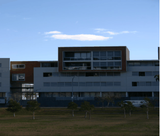
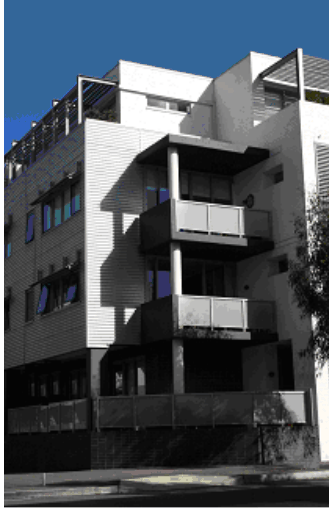
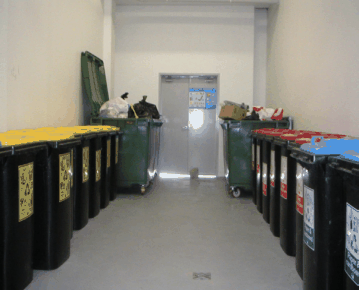

### 4.2 General Requirements for Residential Flat Buildings and Mixed

#### Use Development

This section sets out general development controls relating to residential flat buildings and  mixed use development that are higher than 2 storeys.

#### Objective:

■

■ Ensure that residential flat buildings and mixed use development, offer a high level of residential amenity and make a positive contribution to the creation of new, high quality and contemporary urban streetscapes by:

### •• achieving well articulated building forms that avoid a plain bulky

and monolithic appearance;

•• adopting appropriate building scale, massing and proportions that best reflect the desired future character of the area; and

### •• demonstrating high architectural value.

■

■ Ensure that residential dwellings within mixed use development include design measures that minimise the impact of the normal operation of non-residential activities on the amenity of the occupants of the residential dwellings.

■

■ Ensure that non-residential components of the building (i.e lower level retail and commercial) include design measures and are to minimise noise, odour, light spill, and air pollution impacts upon residential properties.

> [Picture on page 2: a picture, saved as a picture (images/vol-3-part-04-residential-flat-buildings-and-mixed-use-devel-page-2-28.gif, 150 dpi).]

#### 4.2.1 Relationship of the Plan to SEPP ........65 Design Quality of Residential ........Flat Development

a)	 In addition to  satisfying   the

Figure 4.2.1 Example of contemporary residential flat building.

requirements  of  the DADCP, all residential flat buildings,and mixed use development having a height greater than 12 metres or 4 or more self-contained dwellings (whether or not the building includes uses for other purposes, such as  shops) shall satisfy all the standards within State Environmental Planning Policy No. 65

- Design Quality of Residential Flat Development (SEPP 65) and Apartment

Design Guide (Published by the NSW Department of Planning and Environment, July 2015).

#### General

#### 4.2.2 Building Form and Character

#### Requirements

#### Design Requirements:

#### for Residential

a)	 The maximum height of residential flat

#### Flat Buildings and Mixed Use Development

buildings and mixed use development shall be a maximum of two (2) storeys above ground level (existing), except  as specified in any site specific DCPs that applly to the  deferred areas.

a)	 Building design shall consider foremost the qualities (both natural and built) and the desired future character of the areas including the significance of any heritage item on the land.

b)	 Building design shall incorporate the following features to assist in the achievement of high quality architectural outcomes:

> [Picture on page 3: a picture, saved as a picture (images/vol-3-part-04-residential-flat-buildings-and-mixed-use-devel-page-3-26.gif, 150 dpi).]

Figure 4.2.2 Example of external facade treatment that provide variety and articulation through use of varying material types and variation of building vertical height elements.

i)	 incorporation of appropriate facade treatments that help the development properly address the respective street frontages, key vistas and to add visual interest to the skyline;

ii)	 incorporation of articulation in walls, roof lines, variety of roof pitch, individualised architectural features (balconies, columns, porches, colours, materials etc) into the facade of the building;

iii)	variation in the vertical planes of exterior walls in depth and/or direction;

iv)	variation in the vertical and horizontal planes of the building so that the building appears to be divided into distinct base, middle and top massing elements;

v)	 articulation of  building facade (including rear and side elevations visible from a public place) by appropriate use of colour, arrangement of facade elements, and variation in the types of materials used;

vi)	utilisation of landscaping and interesting architectural detailing at the ground level; and

| 4.2 | vii) avoidance of blank walls at ground and lower levels. |  |
|---|---|---|
| General | c) Building design shall demonstrate |  |
| Requirements | to Council’s satisfaction that the |  |
| for Residential | development will: |  |
| Flat Buildings | i) facilitate casual surveillance and active interaction with the street; |  |
| and Mixed Use | ii) be sufficiently setback from the |  |
| Development | property boundary to enable the planting of vegetation to soften the visual impact of the building at street level; and iii) maximise cross flow ventilation, therefore minimising the need for air conditioning. d) Building colours, materials and finishes shall generally achieve subtle contrast. The use of highly reflective or gloss materials or colours shall be minimised to feature and highlight element only. e) Building materials shall be high quality, durable and low maintenance. 4.2.3 Site Services Design Requirements: |  |
|  | a) The location, design and construction of utility services shall satisfy requirements | Figure 4.2.3 – Location of site services for a residential flat building. |
|  | of the relevant servicing authority and |  |
|  | Council. |  |
|  | b) Development shall ensure that adequate |  |
|  | provision has been made for all |  |
|  | essential services (i.e water, sewerage, |  |
|  | electricity, gas, telephone, internet and |  |
|  | stormwater drainage). |  |
|  | c) All roof-mounted air conditioning or |  |
|  | heating equipment, vents or ducts, lift |  |
|  | wells and the like shall not be visible from |  |
|  | any public place and shall be integrated |  |
|  | into the design of the development. |  |
|  | d) All communication dishes, antennae and |  |
|  | the like shall be located or integrated |  |
|  | into the built form so as to minimise |  |
|  | visual prominence. |  |

e)	 An external lighting plan shall be prepared by a suitably qualified person and submitted with the development application.

#### General Requirements for Residential

f) All site services areas including any associated equipment and storage structures  shall be incorporated into the design of the building and screened from public view.

#### Flat Buildings

g)	 An on-going waste management plan shall be

#### and Mixed Use

prepared by a suitably qualified person and submitted with the development application.

#### Development

#### 4.2.4 Acoustic Privacy

a)	 Residential flat buildings, and the residential component of a mixed-use development shall provide noise mitigation measures to ensure that the following LAeq levels are not exceeded:

i)	 in any bedroom in the building—35 dBA ,

ii)	 anywhere else in the building (other than a garage, kitchen, bathroom or hallway)—40 dBA.

b)	 Residential flat buildings, and the residential component of a mixed-use development near railway corridors and major roads shall demonstrate to Council’s satisfaction compliance with the requirements under the Guidelines entitled Development Near Rail Corridors and Busy Roads – Interim Guideline, 2008) (This Guide is available for view/download from the NSW Department of Planning & Environment website at: www. planning.nsw.gov.au).

Note: Noise mitigation measures for residential flat buildings and the residential component of a mixed use development may include insulating building elements such as doors, walls, windows, floors, roof and ceilings. Options for window design include sealing air gaps around windows and doors, laminated or thick glass, and double-glazing.

#### 4.2.5 Vehicular Access

a)	 Residential flat buildings and   mixed-use developments shall only be permitted where Council is satisfied that existing road networks are capable of providing safe and efficient

vehicle access  to and from the proposed development.

#### 4.2.6 Stormwater Drainage

#### General

a)	 Residential flat buildings and   mixed-use

#### Requirements for Residential Flat Buildings and Mixed Use Development

developments shall only be permitted where Council is satisfied that sufficient provisions made for the management of stormwater. All necessary upgrades to existing public and private stormwater infrastructure shall be addressed as part of the proposed development and shall be in accordance with Council’s Engineering Design Guide for Development (available from Council’s website at www.campbelltown.nsw.gov. au)

#### 4.2.7 Thermal Comfort

a)	 Residential flat buildings and mixed-use developments shall be designed to maximise natural thermal comfort for occupants through the use of appropriate building materials. Examples include the use of energy efficient glazing and/ or shading devices for windows and the like.

#### 4.2.8  Waste Management

#### 4.2.8.1 Number of Bins

a)	 All buildings shall be provided with household garbage bins at the following rates:

i)	 a 240 litre bin per 2.5 dwellings/ week for household garbage; or

ii)	 1,100 litre bulk bin per 10  dwellings or part thereof, but only if the bulk bin is stored and located within the property where the waste collection truck is able to enter and exit the property in  a forward-in forward-out arrangement with a maximum three point turning path.

b)	 All buildings shall be designed with provision for recyclable bins at a ratio of one 240 litre bin per 2.5 dwellings per fortnight.

#### 4.2.8.2 Waste Service Rooms, Garbage Chutes and Provision for Recyclables Bins

#### General

a)	 All buildings with a rise of four (4)  storeys or

#### Requirements for Residential

more  shall make provision for a waste service room on each section of each level which is accessible  for all occupants.

#### Flat Buildings

b)	 All waste service rooms shall have chutes to enable residents to dispose of garbage.

#### and Mixed Use

c)	 Chutes shall not be located adjacent to

#### Development

bedrooms or living rooms unless bedrooms unless they are outside the sound transmission barrier surrounding each unit.

d)	 Chutes shall feed into appropriately sized bins located in the bin storage room.

e)	 The outlet area, in which the chute outlets and mechanical collection devices are located, shall be secured to prevent access by unauthorised persons.

f) While mechanical devices are permitted in order to assist with waste collection (eg. carousel), no compaction is permitted for either garbage or recyclables.

g)	 Each waste service room shall make provision for a sufficient number of 240-litre mobile recyclable bins for residents on each floor to dispose of recyclables.

#### 4.2.8.3 Bin Storage Room

> [Picture on page 7: a picture, saved as a picture (images/vol-3-part-04-residential-flat-buildings-and-mixed-use-devel-page-7-34.gif, 150 dpi).]

Figure 4.2.4- Example of a garbage and recycling collection room (Internal view).

#### Design Requirements

a)	 The development shall make provision for an appropriately sized bin storage room(s) that provides convenient access for occupants and waste collection personnel . The storage room shall:

i)	 be located behind the primary and secondary building alignment;

ii)	 have a non slip floor constructed of concrete or other approved material at least 75mm thick and provided with a ramp to the doorway (where necessary);

iii)	be graded and drained to a Sydney Water approved drainage fitting;

iv)	have coving at all wall and floor

| 4.2 | intersections; v) be finished with a smooth faced, non- |
|---|---|
| General | absorbent material(s) in a light colour and |
| Requirements | capable of being easily cleaned; |
| for Residential | vi) be provided with an adequate supply of hot and cold water mixed through a centralised |
| Flat Buildings | mixing valve with hose cock; and |
| and Mixed Use | vii) have a self-closing door openable from |
| Development | within the room. |
| b) | Bin storage rooms shall be ventilated by: i) a mechanical exhaust ventilation system; |
|  | or |
|  | ii) permanent, unobstructed natural |
|  | ventilation openings having direct access |
|  | to external air, and a total area of not less than one-twentieth (1/20th) of the floor |
|  | area of the room. |
| c) | Exterior doors of communal bin storage rooms |
|  | shall be: |
|  | i) consistent with the overall design of the |
|  | building; |
|  | ii) located away from the frontage of the |
|  | building; and |
|  | iii) if collection service is to be carried out by Council), fitted with a Council compatible |
|  | keyed locking system that provides access |
|  | to the room or activates the electronic |
|  | opening and closing of the door. |
| d) | All bin storage rooms and service rooms shall |
|  | be constructed in such a manner to prevent |
|  | the entry of vermin. |
| e) | All bin storage rooms must be located in an |
|  | area where bins can be easily moved to the |
|  | waste collection point. |
| f) | Where waste collection personnel are required |
|  | to enter the premises to service bins, the collection point shall be no further than five |
|  | metres from the collection vehicle. |
| g) | Where residents have access to bin storage |
|  | rooms, signage on the correct use of the waste |
|  | management system shall be displayed in all |
|  | bin storage rooms. |

h)	 Developments must make provision for the storage of bulk waste (kerbside clean-up) materials, including:

#### General

i)	 a minimum  area of 10sqm;

#### Requirements

ii)	 the area must be accessible to all

#### for Residential

residents;and

#### Flat Buildings

iii)	the area must not be more than 10 metres

#### and Mixed Use

from the waste collection point.

#### Development

#### 4.2.8.4 Waste  Collection

a)	 Any development containing 20 or more dwellings and/or the number of bins proposed cannot be accommodated within 50% of the development’s frontage on collection day (the calculation shall allow for 300mm separation distance on either side of each bin) shall be designed to accommodate a forward-in forward-out drive-on collection for on-site servicing. The designated area must meet the following requirements:

i)	 there shall be a minimum height clearance of 5.2 metres;

ii)	 there shall be provision for a waste collection vehicle to empty bins on the vehicle’s left side, allowing for a width of 3.8 metres from the right side of the vehicle to the collection point;

iii)	where the waste collection vehicle is required to turn around on site, there must be provision for a vehicle of 10.4 metres length to negotiate a maximum three-point turn allowing the waste collection truck to enter and leave the property in a forward direction;

iv)	the maximum grade of any path of travel for collection vehicle shall be 1V:20H for the first 6 metres from the street, and 1V:12H thereafter;

v)	 the minimum path width for a collection vehicle shall be 3.6 metres wide; and

vi)	constructed to withstand the  loaded mass of the waste collection vehicle of 24 tonnes.

#### 4.2.8.5  Strata Subdivision

a)	 No more than 50% of the required car

#### General Requirements for Residential

parking within a strata title subdivision shall be allocated to individual commercial units within the mixed-use development.

#### Flat Buildings

b)	 All car parking spaces that are allocated

#### and Mixed Use to  individual units shall be  proportioned

in number to the size of the units.

#### Development

c)	 No car parking spaces shall be created as a separate allotment.

d)	 Car parking provided for the residential dwellings shall be secured, separated from  commercial car parking (where relevant) and have a separate access.

e)	 The design of car parking spaces shall take into consideration the principles of Crime Prevention Through Environmental Design (CPTED) to minimise opportunities for crime and enhance security.

f) No internal or outdoor storage space shall be created as a separate allotment.

#### 4.2.8.6  Access for People with Disabilities

#### Design Requirements

a) Residential flat buildings and mixed use development  shall comply with the minimum access requirements contained within  the BCA , the Disability (Access to Premises — Buildings) Standards 2010 and Australian Standard 1428 – Design for Access and Mobility (as amended).
