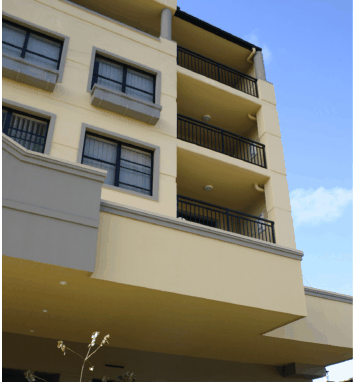
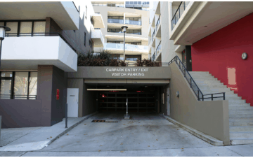

### 4.4 Mixed Use Development

#### Mixed Use

#### Objectives:

#### Development

■

■ To encourage high quality, mixed-use development, which is innovative and responsive to the site’s environmental characteristics and setting.

■

■ To ensure a high level of amenity for the occupants of mixed-use development,

> [Picture on page 18: a picture, saved as a picture (images/vol-3-part-04-residential-flat-buildings-and-mixed-use-devel-page-18-10.gif, 150 dpi).]

and adjoining occupants of residential buildings.

#### 4.4.1 General Requirements for Mixed-use Development

#### Design Requirements

a)	 The requirements for mixed-use development shall be consistent with the requirements for residential flat buildings (Section 4.3 except as specified in this section).

b)	 Mixed-use developments shall only be occupied at ground level by retail and/or commercial office or like uses, subject to land use permissibility under LEP 2002;

c)	 Any mixed-use buildings that are designed to accommodate the preparation of food from a commercial tenancy, shall provide ventilation facilities to ensure that no odour is emitted in a manner that adversely impacts upon any residents or other occupants using the building. Figure 4.4.1 – Example of mixed-use

development.

> [Picture on page 18: a picture, saved as a picture (images/vol-3-part-04-residential-flat-buildings-and-mixed-use-devel-page-18-33.gif, 150 dpi).]

#### 4.4.2 Site requirements and Building Envelope  for Mixed-use          Development in areas zoned B3 & B4

#### Design Requirements

a)	 Council may consider a mixed-use development on land with an area less than 1,200 square metres and a width less than 30 metres.

b)	 Mixed use buildings shall be setback a minimum of:

i)	 zero metres from any street boundary; and

Figure 4.4.2 – Example of vehicle access point for a mixed-use development.

ii)	 6 metres from any other boundary for

any residential component of the building.

#### 4.4.3 Car Parking and Access

#### Mixed Use

#### Design Requirements

#### Development

a)	 In addition to residential car parking rates (section 4.3.4), the development shall provide one (1) car parking space per 25sqm of leasable floor space at ground level and one

(1) car parking space per 35sqm of floor space at upper levels for all commercial/retail parts of the building.

b)	 Pedestrian access to residential flats shall be separated from the commercial/retail uses.

c)	 The development shall provide adequate space for the on-site parking, loading and unloading of all delivery/service vehicles as detailed in Part 5.3 Car Parking and Access of the DADCP.

#### 4.4.4 Roof Terraces

#### Design Requirements

a)	 Consideration will only be given to the provision of a roof top terrace as part of communal open space, subject to appropriate landscaping treatment and recreation facilities provided; and satisfying the respective provisions of the RFDC.

#### 4.4.5 Mixed-use Development and        Waste Management

#### Design Requirements

a)	 Self contained and lockable areas shall be provided for commercial and residential waste.

b)	 Areas for commercial and residential waste shall be kept separate.

### This page is intentionally left

### blank.
