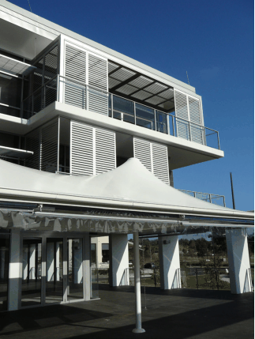
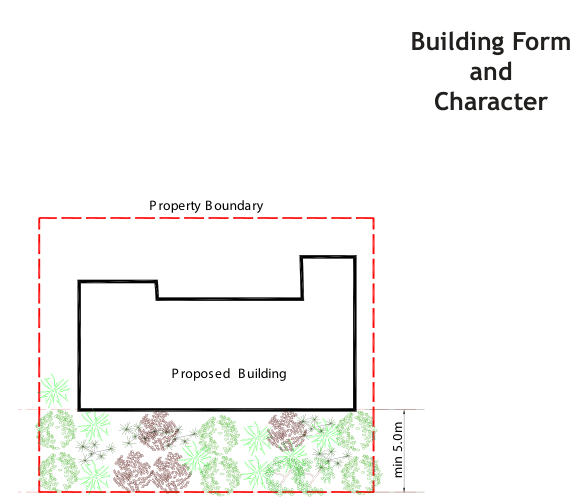
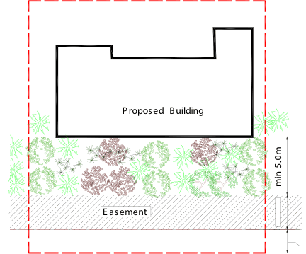

### 5.2 Building Form and Character

#### Objectives:

■

■ Ensure that the massing and scale of new development are complementary to the desired future character of business centres.

■

■ Ensure that buildings are designed to enhance the existing and future desired built form by encouraging innovative and quality designs that fit harmoniously with their surroundings, and the public domain.

■

■ Ensure that car parking areas and entries to commercial development are appropriately sited, designed and constructed so that they do not detract from the appearance of the development or the streetscape.

■

■ Ensure that advertising is undertaken in a manner that reduces clutter and does not impact on the overall visual quality  of the buildings.

#### Design Requirements

a)	 All building facades, including rear and side elevations visible from a public place or adjacent to residential areas, shall be architecturally treated to enhance the quality of the streetscape.

b)	 Large buildings shall incorporate the following elements to assist in achieving a high quality architectural outcome:

i)	 the provision of vertical and/or horizontal offsets in the wall surfaces at regular intervals, including columns, projections, and recesses; variation to the height of the building so that the building appears to be divided into distinct massing elements;

ii)	 articulation of the different parts of

#### Building Form

a building’s facade by use of colour, arrangement of facade elements, or by varying the types of materials used; and

and

#### Character

iii)	maximising the interior and exterior interactions at the ground level.

c)	 The main entry to the building shall be easily identifiable from the street and directly accessible through the front of the building.

d)	 Large expansive blank walls on ground floor levels or side and rear boundaries shall not be permitted unless abutting a building on an adjoining allotment.

e)	 Roof mounted plant rooms, air conditioning units and other services and equipment shall be effectively screened from view using integrated roof structures and architectural elements.

f) Solid opaque roller doors/shutters over windows and entry doors shall not be permitted on any building that has frontages to a street or a public place.

g)	 Buildings shall not incorporate highly reflective glass.

h)	 A schedule of proposed colours, materials and finishes shall accompany all development applications for new buildings.

i) Development on corner sites shall incorporate splays, curves, building entries and other architectural elements to reinforce the corner as a land mark feature of the street.

j) Except in the case of an outdoor cafe, the design of the development shall not provide for outdoor display and/or storage.

k)	 Commercial development shall be designed to address both primary and secondary street setbacks.

l) Infill development shall respect and

maintain consistency with the established setbacks of existing shopfronts.

#### Building Form

#### 5.2.1 Commercial Development Floor Area

and

#### Character

#### Design Requirements:

a)	 The maximum gross floor area of any

> [Picture on page 4: a picture, saved as a picture (images/vol-3-part-05-commercial-development-page-4-10.gif, 150 dpi).]

Figure 5.2.1 An example of a well articulated commercial building.

single retail premises within any business shall not exceed 500 square metres unless the proposal has been supported by an economic impact assessment, prepared by a suitably qualified person. In this regard, the economic impact assessment shall demonstrate that the economic impacts of the proposed development on the retail hierarchy of affected business areas in the Campbelltown Local Government Area are acceptable, and shall include an assessment of:

i)	 	the trade area of the proposed development;

ii)	 	market demand within the trade area to justify the proposal; and

iii)		economic impacts on comparative retail outlets in the trade area.

b)	 Despite Clause 5.2.1 a), bulky goods retailing development shall:

i)	 have a minimum gross floor area of 200 square metres; and

ii)	 be permitted to have a  gross floor area greater than 500 square metres.

#### 5.2.2 Building Setbacks

#### Design Requirements:

a)	 Commercial development shall be setback by:

i)	 	30  metres to:

–

– the main southern railway corridor,

–

– the South Western Freeway corridor,

ii)	 15 metres to:

–

– Badgally Road,

–

– the south eastern side of Blaxland Road between Rose Street and Lot 5 DP 538258,and

> [Picture on page 5: a picture, saved as a picture (images/vol-3-part-05-commercial-development-page-5-5.gif, 150 dpi).]
> Words printed on the picture (title and legend, copied from the PDF):
> Property Boundary
> Proposed  Building
> min 5.0m

#### Building Form

–

– Blaxland Road between Lot 5 DP 538258 and Narellan Road,

and

#### Character

iii)	10 metres from any other public road,

excluding any required road widening.

b)	 Despite Clause 5.2.2 a) i)  Council may consider a reduction of the rear setback from the southern railway corridor from 30 metres to 5 metres providing that:

i)	 a vegetated screen/landscape area of a minimum width of 5 metres is constructed along the full width of the property between the railway corridor  and the buildings;

S outhern R ailway Line Boundary

ii)	 the vegetated  area is free of any

Property Boundary

> [Picture on page 5: a picture, saved as a picture (images/vol-3-part-05-commercial-development-page-5-27.gif, 150 dpi).]
> Words printed on the picture (title and legend, copied from the PDF):
> Proposed  Building
> min 5.0m
> E asement

easements  or site constraints (refer to Figure 5.2.1);

iii)	the vegetated area is densely landscaped with trees and plants selected from the Campbelltown Native Gardening Guide, available from Council’s website at www. campbelltown.nsw.gov.au;

iv)	Council is satisfied that the proposed vegetation is sufficient to screen the buildings from the southern railway corridor.

S outhern R ailway Line Boundary

less than 5.0m

Note: All reduced setback proposals from the railway corridor shall be subject to the approval of the relevant public authorities.

Figure 5.2.2 Illustration of the reduced set backs requirements from the southern railway corridor

#### 5.2.3 Fencing

a)	 Commercial fencing shall be a maximum

2.4 metres in height.

b)	 The use of sheet metal fencing is not permitted.

c)	 Fencing on corner allotments shall not obstruct the sight distance of traffic entering or within an intersection or

roundabout.

d)	 Fencing shall not obstruct power,

#### Building Form

and

#### Character

water, sewer, gas or telephone services, drainage systems, (including overland flow paths) or any easements or rights of way.

e)	 Details for fencing shall be submitted with the development application.
