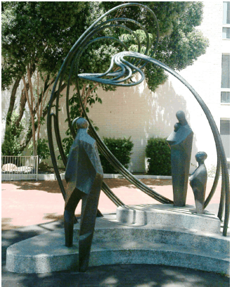

### 5.4 5.4  Public Domain

#### Objectives:

#### Public

#### Domain

■

■ Ensure that commercial development enhances and integrates with the existing public domain.

■

■ Ensure that public art is provided in accordance with Council’s Public Art Master

> [Picture on page 14: a picture, saved as a picture (images/vol-3-part-05-commercial-development-page-14-10.gif, 150 dpi).]

Plan.

#### Design Requirements

a)	 A public domain plan incorporating street furniture, paving, landscaping and public art shall be submitted as part of any development application for a new development having a gross floor area greater than 5,000sqm.

b)	 Any development application for a new development having a gross floor area greater than 5000sqm shall provide public art of a type and location that is acceptable to Council.

c)	 Any commercial outdoor areas fronting the street and used by the general public shall be designed to compliment the surrounding public domain and spaces.

d)	 Awnings shall:

Figure 5.4.1 -  An example   of public art within  commercial centres.

i)	 be 2.5 metres wide;

ii)	 be setback from the kerb by a minimum of 1 metre; and

iii)	provide a minimum of 3 metres clearance to the underside of the fascia.
