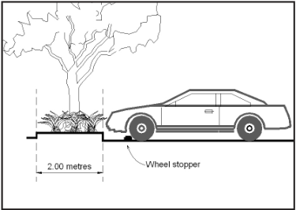
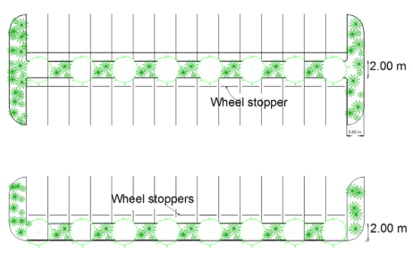

### 5.5 Landscaping

#### Landscaping

#### Objectives:

■

■ Enhance the existing streetscape and promote a scale and density of planting that softens the visual impact of buildings.

■

■ Encourage the planting of native and low water consumption plants and trees.

■

■ Ensure that landscaping is in scale with the development.

■

■ Encourage appropriate placement of vegetation that provides both shade and solar access opportunities at various times of the year.

> [Picture on page 15: a picture, saved as a picture (images/vol-3-part-05-commercial-development-page-15-14.gif, 150 dpi).]

> [Picture on page 15: a picture, saved as a picture (images/vol-3-part-05-commercial-development-page-15-15.gif, 150 dpi).]

#### Design Requirements

a)	 A detailed landscape plan and report shall be prepared by a suitably qualified person and submitted with all development applications for commercial development involving the construction of a new development.

b)	 Landscaping shall be provided between the primary street boundary and the building in accordance with Section 2.5 Landscaping of this Plan.

c)	 All landscaped bays shall be a minimum 2 metres wide and allow for deep soil planting.

d)	 Landscaped areas shall be separated from driveways and car parking areas by a suitable device such as bollards or concrete wheelstops to ensure that the landscaping is not damaged as a result of vehicular movement.

e)	 Landscaped area  at ground floor level

Figure 5.5.1 - An illustration of the need to use wheel stoppers to protect landscaping and the need to landscape all parking edges and between parking bays.

shall be incorporated within the car park at all the outer edges of car parking bays as illustrated in Figure 5.5.1.

#### Note:

f) High canopy trees shall be used to allow for clear lines of sight within car parking areas and to internal site access pathways.

Refer to Section 2.5 Landscaping of Part 2 of Volume 1 of the Plan for additional requirements on Landscaping.
