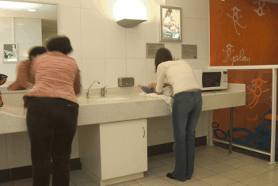

### 5.9 Parenting Facilities

#### Parenting

#### Objective:

#### Facilities

■

■ Ensure that adequate parenting facilities are provided within large scale commercial and retail developments.

■

■ Provide easily accessible, safe and adequately equipped parenting facilities suitable for feeding and other purposes related to the care of babies/infants by both female and male carers.

#### 5.9.1 Development Applications to which this Section Applies

#### Design Requirements

A parenting facility is a room which is equipped with facilities  for

a)	 Parenting facilities shall be incorporated

feeding (including breast feeding) and caring of babies/infants.

> [Picture on page 19: a picture, saved as a picture (images/vol-3-part-05-commercial-development-page-19-20.gif, 150 dpi).]

in all new buildings and alterations/ refurbishment of existing buildings for regional and district shopping centres, major sporting facilities, swimming centres, community facilities, libraries, hospitals, theatres, cinemas, department stores, and any other building where in Council’s opinion such facilities should be provided.

#### 5.9.2 General Requirements

#### Design Requirements

a)	 Each parenting facility shall be designed to:

Figure 5.9.1 - An example of a parenting facility.

i)	 provide a quiet place for parents to feed children in privacy;

ii)	 be a unisex use facility;

iii)	provide an allocated area to change nappies;

iv)	provide hand washing (warm and

cold) and drying facilities;

v)	 provide a toddler toilet;

vi)	be separated from male, female and disabled toilets; and

vii)	be well ventilated  in accordance with Australian Standard 1668 Part 2- Acceptable Indoor Air Qualities (as amended).

### This page is intentionally left

### blank.
