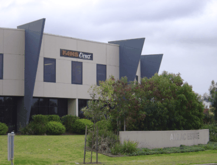
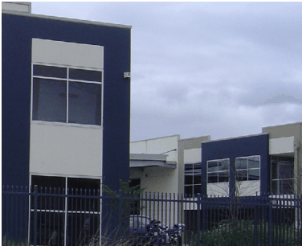
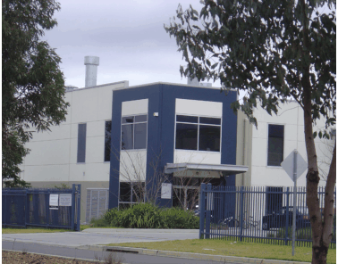
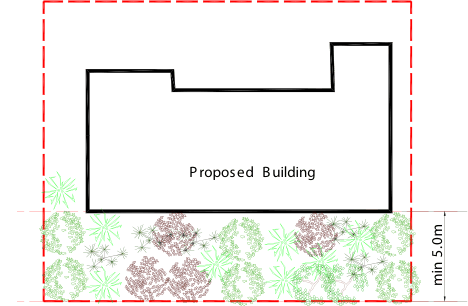
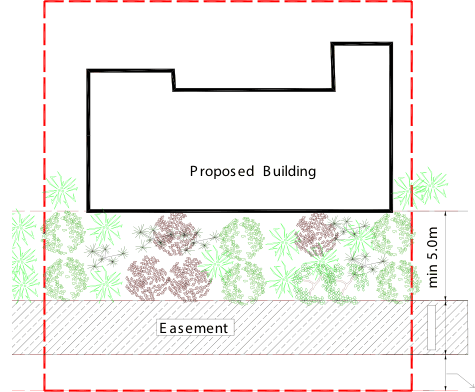
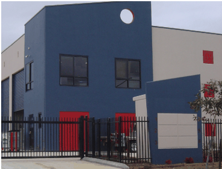

### 6.2 Building Form and Character

#### Objectives:

■

■ Ensure that industrial development is both functional and attractive in the context of its local environment through appropriate design.

■

■ Reduce the visual impact of industrial development on the streetscape and surrounding areas.

■

■ Ensure that sufficient areas are available for landscaping, access, and car parking and manoeuvring of heavy vehicles on site.

■

■ Ensure that building materials are high quality and durable.

■

■ Ensure that fencing and walls for security purposes have positive impacts on the streetscape and other public domain areas.

■

■ Ensure that industrial development does not significantly impact on adjoining

> [Picture on page 2: a picture, saved as a picture (images/vol-3-part-06-industrial-development-page-2-28.gif, 150 dpi).]

residential zones.

#### 6.2.1 Building Design

#### Design Requirements

a)	 Building design shall incorporate the following features to assist in the reduction of the perceived bulk and mass of development:

i)	 provision of vertical and/or horizontal offsets in the wall surfaces at regular intervals, including columns, projections, and recesses;

ii)	 articulate architectural details around doors, windows front facades, roofs  and entrances;

Figure 6.2.1 An examples of well articulated industrial buildings.

iii)	articulate walls through the use of

#### Building Form

#### Worked example:

and

#### Character

texture, colour, material changes, shadow lines and other facade treatments, at least every 15 metres; and

iv)	at least 50% of the total surface area of the front elevation to be constructed of masonry material.

b)	 Buildings located on corner allotments

For a proposed development that comprises a gross floor area of 100sqm, the office area shall be a maximum of 30 sqm. As such the development would be comprised of:

shall be designed to address both street frontages.

a) 30sqm of office area; and

b) 70sqm of  the primary use.

> [Picture on page 3: a picture, saved as a picture (images/vol-3-part-06-industrial-development-page-3-24.gif, 150 dpi).]

> [Picture on page 3: a picture, saved as a picture (images/vol-3-part-06-industrial-development-page-3-25.gif, 150 dpi).]

c)	 Buildings shall be predominantly single storey (excluding basements, mezzanines and offices).

d)	 Mezzanines shall not comprise an area of more than 50% of the gross floor area of the ground floor of the respective unit.

e)	 Offices shall not comprise more than 30% of the gross floor area of the respective unit.

Note: For the purpose of Clause 6.2.1 e) above, ‘office space’  means the part of the gross floor area that is dedicated to office use.

f) No building shall rely upon a required path of egress (as defined within the BCA) over adjoining private land.

g)	 No building or structure shall be erected within a right of carriage way or easement.

h)	 A schedule  of proposed colours, materials and finishes shall accompany all development applications for new industrial buildings.

i) The main entry to the building shall be easily identifiable from the street and directly accessible from  the front of the building or driveway in the case of a multi unit complex.

Figure 6.2.2 Examples of easily identifiable entry.

#### 6.2.2 Building Setbacks

a)	 Industrial development shall be

#### Building Form

setback by:

and

#### Character

i)	 	30  metres to:

–

– the main southern railway corridor,

Property Boundary

> [Picture on page 4: a picture, saved as a picture (images/vol-3-part-06-industrial-development-page-4-12.gif, 150 dpi).]
> Words printed on the picture (title and legend, copied from the PDF):
> Proposed  Building
> min 5.0m

–

– the South Western Freeway corridor,

ii)	 15 metres to:

–

– Badgally Road,

–

– the south eastern side of Blaxland Road between Rose Street and Lot 5 DP 538258,and

–

– Blaxland Road between Lot 5 DP 538258 and Narellan Road,

S outhern R ailway Line Boundary

iii)	10 metres from any other public road,

Property Boundary

> [Picture on page 4: a picture, saved as a picture (images/vol-3-part-06-industrial-development-page-4-30.gif, 150 dpi).]
> Words printed on the picture (title and legend, copied from the PDF):
> Proposed  Building
> min 5.0m
> E asement

excluding any required road widening.

b)	 Despite Clause 6.2.2.a) i)  Council may consider a reduction of the rear setback from the southern railway corridor from 30 metres to 5 metres providing that:

i)	 a vegetated screen/landscape

S outhern R ailway Line Boundary

less than 5.0m

area of a minimum width of 5 metres is constructed along the full width of the property between the railway corridor and the buildings;

ii)	 the vegetated  area is free

Figure 6.2.3 Illustration of the reduced set backs requirements from the southern railway corridor.

of any easements  or site constraints (refer to Figure 6.2.3;

iii)	the vegetated area is densely landscaped with trees and plants selected from the Campbelltown Native Gardening Guide , available from Council’s website at www. campbelltown.nsw.gov.au;

#### Building Form

iv)	Council is satisfied that the proposed vegetation is sufficient to screen the buildings from the southern railway corridor.

and

#### Character

Note: All reduced setback proposals from the railway corridor shall be subject to the approval of the relevant public authorities.

c)	 Except as nominated above, buildings adjoining residential, commercial and/ or open space zones shall be setback a minimum of 10 metres, the interface of which shall be complimentary to and not pose unreasonable impacts on the non-industrial development in terms of its built form and proposed used.

#### 6.2.3 Fences

#### Design Requirements

a)	 Industrial fencing shall be a maximum

2.4 metres in height.

b)	 All fencing in industrial developments shall be of recessive colours, palisade design, or plastic coated and framed chain wire with a maximum height of

2.4 metres, unless required as part of an acoustic solution.

> [Picture on page 5: a picture, saved as a picture (images/vol-3-part-06-industrial-development-page-5-30.gif, 150 dpi).]

Figure 6.2.4 An example of the use of a palisade fence in an industrial development.

c)	 The use of sheet metal fencing is not permitted unless required as part of acoustic solution and is appropriately screened with landscaping.

d)	 All fencing in industrial developments shall be setback a minimum of 3.0 metres from property boundaries addressing a primary and/or  secondary street.

e)	 Fencing on corner allotments shall not obstruct the sight distance of traffic entering or within an intersection or roundabout.

f) Fencing shall not obstruct power, water, sewer, gas or telephone services, drainage systems, (including overland flow paths) or any easements or rights of way.

g)	 Details for fencing shall be

### Building

submitted with the development application.

### Form

and

### Character
