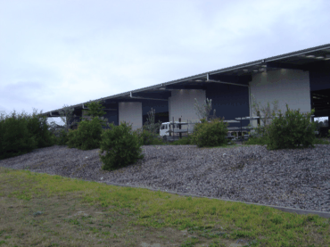
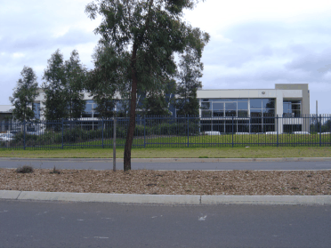

### 6.3  Car Parking and Access

#### Car Parking

#### and Access

#### Objectives:

■

■ To ensure that all required car parking and related vehicle manoeuvring is accommodated on site.

■

■ To maintain the free flow and safe movement of traffic into and out of the site.

■

■ To ensure that on site car parking does not detract from the visual character of

> [Picture on page 7: a picture, saved as a picture (images/vol-3-part-06-industrial-development-page-7-12.gif, 150 dpi).]

> [Picture on page 7: a picture, saved as a picture (images/vol-3-part-06-industrial-development-page-7-13.gif, 150 dpi).]

the streetscape.

#### 6.3.1 General Requirements

#### Design Requirements

a)	 Off street parking  and loading shall be designed in accordance with Australian Standard AS 2890.1 and 2  (as amended), except as otherwise provided by this Plan.

b)	 For that part of the gross floor area occupied by office areas, lunch rooms and any associated office storage areas, car parking shall be provided at a rate of one space per 35sqm.

c)	 For that part of the gross floor area occupied by uses other than office areas, lunch rooms and any associated office storage areas, car parking rates shall be provided in accordance with the following:

i)	 a minimum of two (2) spaces (per unit), plus

Figure 6.3.1 Examples of landscaping incorporated into car parking within industrial areas.

ii)	 one space for every 100sqm of gross floor area for buildings up to 2000 square metres; plus

iii)	one space per 250sqm for that part of the building  exceeding 2000 square metres in  gross floor area.

d)	 In addition to clauses 6.3.1 (b) & (c), one car parking space shall be provided for every 300sqm of outdoor storage space.

e)	 Mezzanine areas that are exclusively used for storage purposes shall be excluded from the calculation of total

#### Car Parking

#### and Access

gross floor area for the purpose of calculating the required number of car parking spaces, providing that the mezzanine areas:

i)	 are not divided into smaller spaces by internal walls; and

ii)	 have no external windows.

f) In addition to clause 6.3.1 (c), motor vehicle industries shall provide a minimum of three (3) car parking spaces per work bay/hoist.

g)	 Sufficient space shall be provided on site so that no vehicle shall be required to make more than a three-point movement to exit the site in a forward direction.

h)	 No car parking spaces shall be designed in  a stacked configuration.

i) No required car parking spaces shall be created as a separate strata or Torrens title allotment.

> [Picture on page 8: a picture, saved as a picture (images/vol-3-part-06-industrial-development-page-8-24.gif, 150 dpi).]

> [Picture on page 8: a picture, saved as a picture (images/vol-3-part-06-industrial-development-page-8-25.gif, 150 dpi).]

Figure 6.3.2 Examples of loading bays provided for individual units and separate from car parking and landscaped areas.

j) Each site shall have a:

i)	 maximum of one ingress and one egress for heavy vehicles (combined or separated).

ii)	 each site may have an additional ingress/egress for cars (and other light vehicles).

k)	 A minimum of 10% of the required car parking spaces, including disabled spaces, shall be located within close proximity to the main pedestrian entry to the building.

Note: Council may consider the use of mechanical turntables as part of the car parking arrangements.

#### 6.3.2 Loading and Unloading

#### Design Requirements

a)	 Each industrial factory/unit shall be provided with a loading bay.

b)	 Provision shall be made for all loading

and unloading to take place wholly within the  designated loading area.

#### Car Parking

c)	 No loading or unloading shall be carried

#### and Access

out across parking spaces, landscaped areas, pedestrian aisles or on roadways.

d)	 Each industrial building/unit having a gross floor area :

#### Note:

i)	 up to 400  square metres shall

For the purpose of this section (Section 6.3.2):

provide a loading area to allow for a small rigid vehicle to manoeuvre on site.

–

– a small rigid vehicle shall

ii)	 more than 400 square metres, but up

be taken to mean a rigid vehicle that has a minimum length of 6.4 metres;

to 1500 square metres shall provide a loading area to allow for a medium rigid vehicle to manoeuvre on site; and

–

– a medium rigid vehicle shall

iii)	more than 1500 square metres shall provide a loading area to allow for a heavy rigid vehicle to manoeuvre on site.

be taken to mean a rigid vehicle that has length greater than 6.4 metres but not exceeding a length of 8.8 metres; and

e)	 Heavy rigid vehicle swept turning paths

–

– a heavy rigid vehicle shall

shall be provided demonstrating that a heavy rigid vehicle can enter and exit the site in a forward direction for all industrial sites.

be taken to mean a rigid vehicle that has a length greater than 8.8 metres but not exceeding a length of 12.5 metres.

f) Where it is proposed to service the site with articulated vehicles exceeding 12.5m in length, swept turning paths are to be provided for that vehicle type.

Refer to AS 2890.2 (as amended) for more information on heavy rigid vehicle measurements and classifications.

#### 6.3.3 Access for People with Disabilities

#### Design Requirements

a)	 Industrial development shall comply with the minimum access requirements contained within  the BCA, the Disability (Access to Premises — Buildings) Standards 2010 and Australian Standard 1428 – Design for Access and Mobility (as amended).
