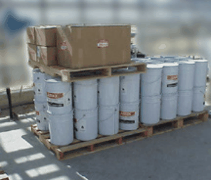

### 6.5 Outdoor Storage Areas

#### Outdoor Storage

#### Areas

#### Objectives:

■

■ To ensure that outdoor storage areas are appropriately accommodated on site.

■

■ To reduce the visual impact of outdoor storage areas on the streetscape and

> [Picture on page 11: a picture, saved as a picture (images/vol-3-part-06-industrial-development-page-11-9.gif, 150 dpi).]

surrounding areas.

#### Design Requirements

a)	 No outdoor storage shall occur without development consent.

b)	 Outdoor storage areas shall not be located between the primary or secondary street boundary and  any building on the allotment.

c)	 Outdoor storage areas shall be adequately screened from public view.

d)	 Goods and materials stored shall not be stacked higher than an approved screening structure.

e)	 Screen fencing and structures shall be

Figure 6.5.1 - An example of unacceptable solution for outdoor liquid storage area

constructed of high quality materials that complement the buildings located on site.

f) All outdoor storage areas shall be sealed and drained to the storm water system in accordance with any environmental management requirements.

g)	 Notwithstanding any other provision of this Plan, no external storage of used unregistered motor vehicles, vehicle parts, used building materials, scrap products or other industrial waste shall be permitted.

h)	 No above ground tanks or other storage facilities shall be erected within a required setback.

i) Goods shall be stored above the flood planning level.
