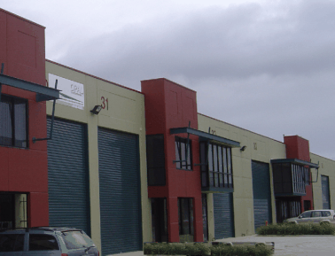

### 6.9 Industrial Unit/s

#### Multi Unit

#### Complexes

#### Objectives:

■

■ Ensure that the design of industrial units provide sufficient facilities to ensure the orderly development and relationship of a number of industrial activities on

> [Picture on page 16: a picture, saved as a picture (images/vol-3-part-06-industrial-development-page-16-8.gif, 150 dpi).]

the site.

#### Design Requirements

a)	 Each industrial unit/s proposed on land zoned 4(a) General Industry under Campbelltown (Urban Area) LEP 2002, shall have a minimum LFA of 400 square metres.

b)	 Each industrial unit/s proposed on land zoned 4(b) Industry B and 4(c) Industry C under Campbelltown (Urban Area) LEP 2002, shall have a minimum LFA of 100 square metres.

Figure 6.9.1 -  An example of a multi-unit complex with individual loading/ parking for each unit.
