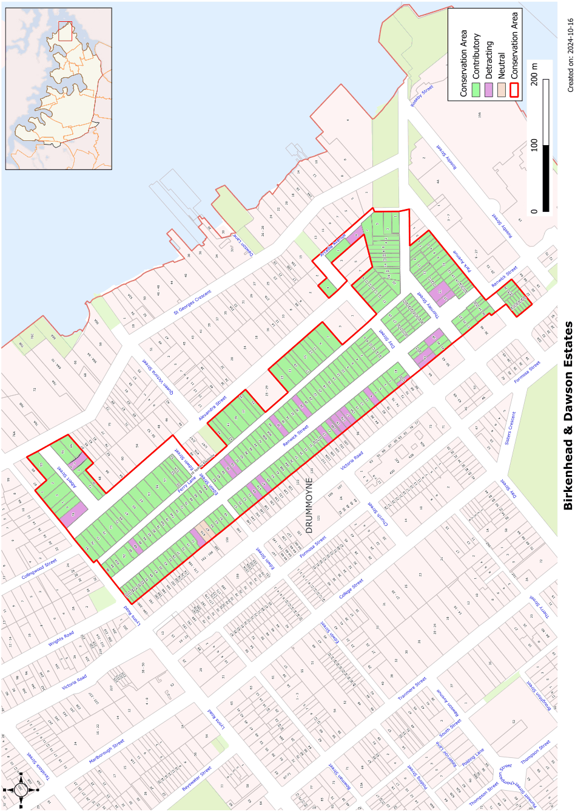

### Statements of significance

### CA.1  Birkenhead and Dawson Estates Conservation Area

#### History

This conservation area includes the subdivisions of two major estates. The first was the 1882 Birkenhead Estate subdivision that included the land bounded by Lyons Road, Victoria Road, Ferry Lane, Ferry Road, and Iron Cove Bay. That was followed in 1901 by two subdivisions of the Dawson Estate that included most of the land to the east of Ferry Lane. A third subdivision of the Dawson Estate in 1908 included the land between Albert Street, Alexander Street and Queen Victoria Road.

Development in this Conservation Area followed the subdivisions and houses from the Victorian period survive in Renwick Street and on Park Avenue, Thornley Street and Day Street. Most of the remaining development is from the Federation period, reflecting the continued development of the Birkenhead Estate and the rapid development of the Dawson Estate subdivisions.

#### Description

This area contains some of the earliest surviving buildings in Drummoyne with an interesting collection of buildings from the late Victorian period including a number of stone houses in Renwick Street. The area is also of historical interest with the very high retention rate of items of heritage significance in Renwick Street due to its long term road widening affectation which effectively prevented any development for over 20 years. This has resulted in this group of properties surviving as the most intact early and modest housing streetscape in the Municipality.

The styles of housing in the Conservation Area reflects the various subdivisions. Renwick Street was developed early in the development of Drummoyne, along with other streets close to Victoria Road. In contrast the adjoining streets released for development at a later period are more typical of the strong Federation character of Drummoyne.

The scale of building is modest with a large number of simple timber cottages, stone cottages and generally unpretentious buildings. This is particularly seen in Alexandra Street and Day Street.

The area falls into three distinct characters:

• Renwick Street with its late Victorian through to inter-war housing

• Alexandra, Albert and Day Streets which have a predominantly Federation character and

• Thornley Street and Park Avenue which have a mix of Edwardian, Federation and several late Victorian buildings.

The generally narrow allotments (15-16m frontages) has resulted in tightly packed development. Access to the rear of allotments on Alexandra Street and Renwick Street has allowed garages and carports to be built away from the main streetscape.

#### Statement of Significance

The Birkenhead and Dawson Estates Conservation Area is of high heritage significance for the very intact and complete streetscapes reflecting the intense development of Drummoyne in the late nineteenth and early twentieth century. The styles of housing clearly reflect the pattern of subdivision of the area.

This Conservation Area includes extensive groups of Federation and Edwardian housing interspersed with Victorian cottages and some larger two storey homes. The narrow allotments and generally consistent scale of development create a cohesive and interesting streetscape.

#### Analysis - Setting

This conservation area has narrow allotments. Setbacks are generally smaller closer to Victoria Road. Street trees are important in contributing to the character of much of this area. The angled junction of Ferry Lane and Thornley Streets gives additional interest to the streetscape in that part of the Conservation Area.

#### Scale

Most of the housing has single storey frontages to the street, consistent with the narrow allotments. Two storey housing is scattered through the area. Some semi-detached housing utilising double allotments is included in the area and gives the impression of larger scaled housing.

#### Form

Some of the earlier development has simple rectangular massing with simple hipped roofs and verandahs running across the full width of the houses. The dominant Federation period housing breaks up the overall massing with projecting wings and more complex roof forms. Gables are used either as decorative features or as the main roof form. The two storey housing on the smaller allotments generally has quite simple massing with the main bulk of the building set behind a verandah to help reduce the overall bulk in the streetscape.

Facades usually include verandahs and elements that step forward of the main part of the building. This often adds interest to the roof form as well as the street front of the house. Simple verandahs across the street facades help to soften the impact of the higher two storey facades on the streetscape.

#### Materials and Colours

Face brickwork is the most common original material. Sandstone and render is found on the earlier Victorian housing. Roofs of the Federation and Edwardian housing are usually terracotta or slate shingled. Some cottages have galvanised corrugated steel roofs.

#### Doors and Windows

Doors and windows are usually vertically proportioned. Larger openings, when they occur, are divided vertically.

#### Carparking

Parking is generally at the rear of the property, in some cases taking advantage of rear street access. On steeply sloping sites, some garages have been built into the retaining walls on the street front.

#### Fencing

A mixture of fencing is used and depends to some extent on the nature of the site and the character of the house.

Masonry retaining walls of face brick or stone are used on sloping sites. Low masonry fences of either face brick or stone are common on the early twentieth century development. On some late Federation and Inter-War housing, the brick piers are linked by a pipe rail. Timber picket fences are usually modern reproductions and are not original to the streetscape.

Garden Elements including Paving and

#### Driveways

Hedges are often used where increased privacy is desired. Driveways are often a pair of concrete strips parallel to the side boundary of the house. Terraces provide a setting on steeply sloping sites where houses are located on the high point to maximise views.

#### Refer to Figure App1.1

Development Control Plan

Appendix 1 Conservation Areas

> [Picture on page 4: a picture, saved as a picture (images/appendix-01-conservation-areas-page-4-3.gif, 150 dpi).]

Figure App1.1

Birkenhead and Dawson Estates Conservation Area
