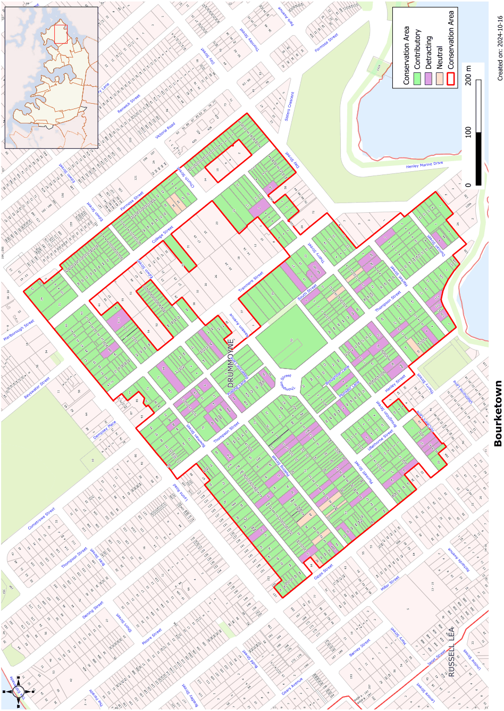

### CA.2  Bourketown Conservation Area

#### History

Bourketown was initially established in the 1840 period making it one of the first planned developments in the area along with Gipps Town at Five Dock. The subdivision had Bourke Square at its centre and was first offered for sale in 1841.

Although some land was taken up little development took place until the area was linked by the Iron Cove Bridge to the city in 1882. The new bridge resulted in further sales and was the start of the development that currently typifies the area. There appear to be no structures remaining from the pre-1880 period of development.

The area between Formosa Street and South Street was re-subdivided in 1883 as the Tranmere Estate. Further re-subdivision of larger blocks continued into the Inter-War period and is reflected in the housing styles.

The most intensive phase of development in the Bourketown area was the Federation period. Speculative developments of semi-detached houses are concentrated closer to Victoria Road and free-standing Federation period houses dominate other parts of the conservation area. A small number of late Victorian houses survive, primarily in the area closer to Bourketown Square. The dominant Federation phase of development is reinforced with a good range of Inter- War housing.

#### Statement of Significance

The Bourketown Conservation Area is of high value in reflecting the principal late Victorian and Federation period of development of the Drummoyne Area. The street layout survives from the original Bourketown subdivision, one of the earliest subdivisions of the area. The focal point of Bourketown is Bourke Square and it is in this vicinity that some of the finest individual buildings and groups of buildings are located, along with a small group of commercial buildings and the Drummoyne Public School.

Bourketown is important for its remaining Victorian housing, particularly in the vicinity of Bourke Square, which includes substantial houses on generous allotments as well as a scattering of worker’s homes. This development is surrounded by the Federation housing that dominates the streetscapes and, importantly, includes a range of housing from semi-detached speculative development closer to Victoria Road, through to smaller freestanding houses, to large houses of high individual value. These are representative of most styles of residential development from the Federation period and include housing for a variety of social classes.

The conservation area includes a number of important urban buildings including four churches, a public school, commercial buildings and a major water reservoir all relating to the early twentieth century development of the precinct and all of high value both individually and for understanding the development of the area.

#### Future Character

The future character for this large and mixed area is principally to retain the strong overall heritage urban character of the streets with their mix of one and two storey houses on lots of mixed size.

Existing building stock is predominantly Victorian and Edwardian with some Inter-war pockets of housing and these characters should be retained. Buildings built prior to the Second World War should not be demolished and new buildings should retain the scale and overall character of the immediate area as it relates to bulk, form and use of materials. Given the large lot sizes for much of the area, additions and new buildings can be in a range of forms including good contemporary design with the emphasis on ‘fit’ into the setting. Garages and carports should not be added in front of the building line.

#### Analysis - Setting

The area falls into a number of separate zones or precincts that are related to groups of streets.

Firstly the major north-south streets linking to Lyons Road: Gipps; Thompson; Tranmere and College Streets. These streets are wide, have long vistas, established street plantings and strong heritage value. They have a strong suburban character with a sense of spaciousness that relates to the scale of houses. The central street, Thompson Street, contains Bourketown Square which is a major public space of high heritage value that represents the first development of the Drummoyne area and forms a focal point in the area. The location of important civic buildings of high heritage value, such as churches and public utilities on these streets adds to their importance in the townscape.

The secondary north-south streets are narrower and have a smaller scale of housing development, greater use of semi-detached forms and a tighter urban fabric. These streets are: Ullathorne, Henley, and Formosa Streets and South Street (for its northern section). Formosa Street in particular is noted for its fine streetscape of semi-detached Federation housing.

The east-west streets have a completely different character. They are narrow (except for Day Street and sections of Plunket and Broughton Streets which are of varying widths) and contain a much tighter sub-division pattern with generally small blocks and far less pretentious houses. This is particularly seen in Bowman and Polding Streets. The western blocks of Polding and Bowman Streets and Plunkett Street contain the largest scattering of Victorian cottages and houses outside Thompson Street.

The major houses are not confined to one location within Bourketown, but the major groupings are in Thompson Street, the south end of Tranmere and South Streets and Lyons Road. The precinct in Thompson Street from Broughton Street to Bowman Street contains the most substantial and significant group of buildings, but this does not devalue the smaller scale buildings around it.

Another distinctive area of the Bourketown Conservation Area is the Lyons Road frontage from Formosa Street to Thompson Street. This frontage, which effectively forms part of the main road frontage rather than the residential character of the rest of the precinct, contains:

• commercial buildings at both the Drummoyne shopping centre, Tranmere Street and Thompson Street corners, several of which are individually important and intact examples of Inter-war retail buildings

• Drummoyne Fire Station

• Drummoyne Presbyterian Church at a key visual location

• blocks of Inter-war apartments of very fine proportion and detailing set amongst a series of substantial Federation and later homes which indicate the predominant early character of this road frontage.

#### Scale

The buildings fall into a range of groups. The predominant form for Thompson Street, South Street and Tranmere Street is single residences of significant scale. Most of Formosa Street and its side streets have single storey semi-detached housing built as speculative development. Other streets have small single fronted cottages or large groups of semi-detached dwellings generally speculatively built as seen for much of the length of Formosa and Edwin Streets and part of Day Street and Bowman Street.

Single storey housing is dominant with two storeys housing usually only confined to freestanding homes on larger allotments or for buildings originally incorporating shops.

#### Form

The dominant Federation period housing in the Bourketown Conservation Area is noted for the use of interesting roof forms with decorative gables providing interest and rhythm to the streetscape.

#### Siting

The siting of buildings in Bourketown is related to the scale of the building and the size of the site. The closely spaced semi-detached groups have small setbacks. Setbacks generally increase on larger allotments.

#### Materials and colours

Red face brickwork is the dominant material in the Bourketown Conservation Area. A few surviving Victorian buildings are rendered but this is the exception and these contrast to the general streetscape. The red tones continue in the terracotta roof tiles used either as a main roof material or as a highlight to the grey slate roofs.

Timber is generally used for verandah framing and joinery elements.

Colours were selected from a limited palette and complement the natural tones and textures of the materials.

#### Doors and Windows

Windows on contributory buildings are almost exclusively timber framed. The dominant Federation period housing has either casement or double hung windows. Larger openings are created by grouping two or three sashes together or by using French doors.

#### Fencing

The small number of Victorian houses in the area had transparent fencing of either iron pickets between masonry posts or timber pickets. The iron picket fencing could be up to 1.8m high on larger blocks, but clear documentation of physical evidence of this would be needed before reproduction of fencing of that height was approved. Most picket fencing would be a maximum of 1.2m high.

The dominant Federation period housing usually had low masonry fencing with panels of timber pickets or wrought steel up to a maximum of 900mm high.

Inter-war period housing in the Bourketown Conservation area usually had face brick fencing with brick piers separated by low brick panels with horizontal steel pipe rails.

#### Subdivision

The late nineteenth and early twentieth century subdivision patterns are typically small allotments. Larger allotments are generally only found with surviving free standing houses or are the sites of churches, schools and other public buildings. The subdivision patterns in the Bourketown Conservation Area are closely related to the rhythm of the streetscape.

#### Refer to Figure App1.2

Development Control Plan

Appendix 1 Conservation Areas

> [Picture on page 8: a picture, saved as a picture (images/appendix-01-conservation-areas-page-8-3.gif, 150 dpi).]

Figure App1.2

Bourketown Conservation Area
