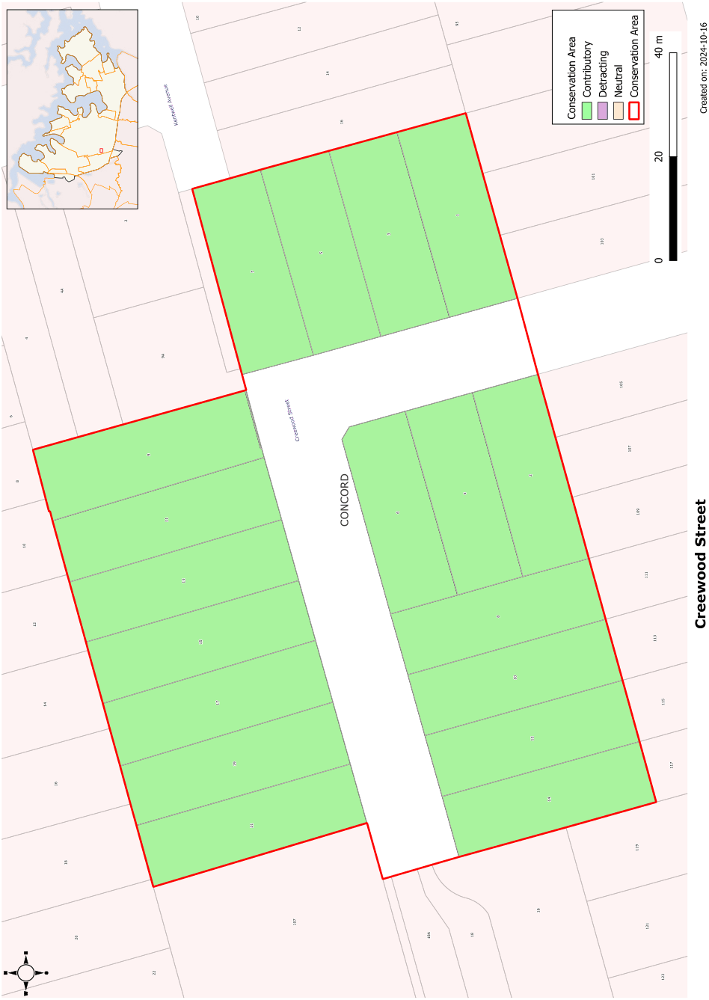

### CA.3  Creewood Street Conservation Area

#### History

Creewood was a prominent house facing Concord Road. The land to the east of the house was developed in two subdivisions creating Creewood Street. The southern and eastern sections were subdivided in 1926 with the northern part of the street subdivided in 1927. Development of Inter-War housing appears to have rapidly followed the subdivision.

#### Description

The development in this short street is characterised by intact Inter-War California bungalows. The houses feature multiple gables facing the street, verandahs across part of the front elevation, dark face brick walling and tiled roofs. The houses retain their landscaped setting with low brick fences with metal railing complementing the low horizontal lines of the housing. The turn in the street adds to the visual amenity of Creewood Street.

#### Statement of Significance

Developed in a short period from 1926, Creewood Street is one of the areas finest streetscapes of Inter- War bungalows. The streetscape is remarkable for the integrity of the landscaping and street fencing.

#### Analysis - Setting

Developed as a cul-de-sac, Creewood Street is a contained streetscape. The bend in the street contributes to the visual quality of the street. Intact fencing, contemporary with the houses is important to the setting of the houses.

#### Scale

Apart from infill development, the housing in Creewood Avenue is all single storey.

#### Form

The houses in Creewood Street are exemplars of Inter-War bungalows, incorporating strong horizontal lines created by the low-medium pitched gables, deep verandahs with simple brick balustrades and heavy verandah piers. Verandahs are always incorporated into the front elevation of the houses, giving depth to the façade.

#### Siting

Setbacks from the front boundary are consistent. Side setbacks include a generous setback on one side to allow driveway access.

#### Doors and Windows

Window openings are usually divided into sets of casement sashes, sometimes with a flat awning and a decorative brick sill. Doors may be multi-paned glazed leafs, sometimes with pairs of doors opening to the verandah.

#### Materials and Colours

Face brick walls of liver or redbrick with commons to side and rear walls. Roofs are usually of terracotta roof tile. The gables are often trimmed with shingles or weatherboards. Verandahs are trimmed with bands of cement render and stub columns.

#### Carparking

Garages and carports are set well behind the building line.

#### Fencing

Fencing has brick piers between panels of brickwork matching the houses. Pipe rails or wrought metal panels join the piers.

#### Refer to Figure App1.3

Development Control Plan

Appendix 1 Conservation Areas

> [Picture on page 10: a picture, saved as a picture (images/appendix-01-conservation-areas-page-10-3.gif, 150 dpi).]

Figure App1.3

Creewood Street Conservation Area
