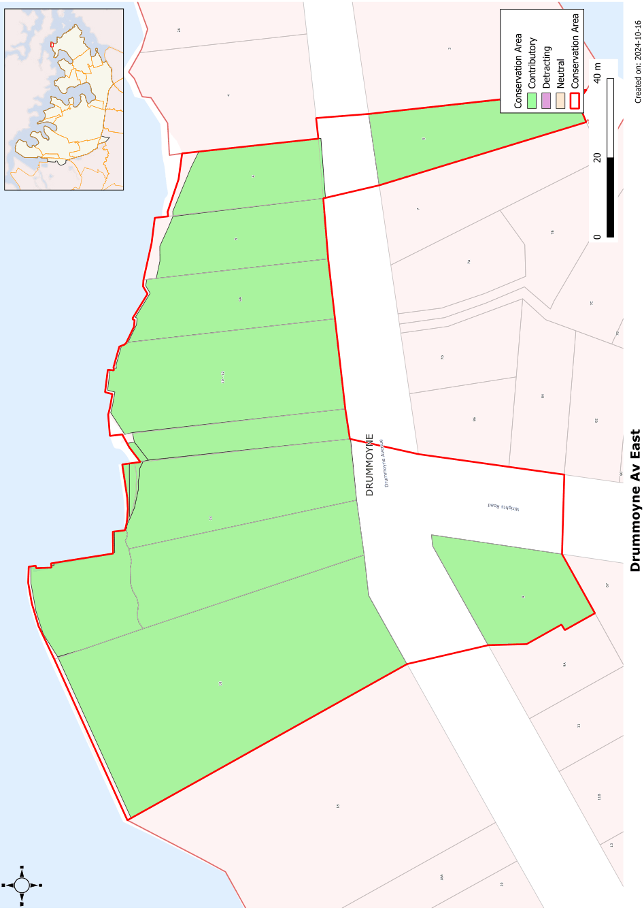

### CA.4  Drummoyne Avenue East Conservation Area

#### History

The subdivision of Drummoyne House in 1894 created suburban allotments at Wrights Point. The proximity to Parramatta River attracted purchasers who could afford to build fine homes, most of which were oriented to the water. This Conservation Area includes some of the finest waterfront houses to survive in Drummoyne. It also includes the house on the southwest corner of Wrights Road and Drummoyne Avenue that, due to its corner location and elevated position, provides a visual link to this group and to the Drummoyne Avenue West Conservation Area.

5 Drummoyne Avenue is the earliest house of the group, probably built soon after the subdivision in 1894. Other houses, with the exception of 8A Drummoyne Avenue, followed in the next 10-15 years.

#### Description

This Conservation Area includes some of the more significant waterfront houses to survive in the Drummoyne Area. They retain their setting with their major orientation to the water. Most of the group are large and notable examples of the Federation Queen Anne style.

Many of the houses retain important elements of their original gardens. Boatsheds and sea walls also contribute to the setting of the houses.

#### Statement of Significance

Drummoyne Avenue East Conservation Area forms one of the last intact groups of waterfront residences on the Parramatta River and has high regional as well as local value. They are indicative of the major development form along the eastern Drummoyne waterfront which has been almost completely obliterated by State Government Planning policies since the 1970's period. This is the last major waterfront group in the Canada Bay Council area and a key group of buildings at the entrance to Parramatta River.

#### Analysis - Setting

The houses in Drummoyne Avenue East Conservation Area respond to their proximity to the water with frontages to Parramatta River as well as to Drummoyne Avenue. Gardens are important to the setting of the houses. Large setbacks from Drummoyne Avenue are used to take advantage of water frontages.

#### Scale

These are generally large houses of one to two storeys located on large allotments that allowed appropriate setbacks from side boundaries.

#### Form

Generally interesting roof forms incorporating hipped and gabled forms. The larger houses also include tower and turret elements

These houses use elements such as bay windows, projecting gabled fronts and verandahs to break down the overall mass of the building.

#### Siting

The houses in this group are sited well back from the street frontage taking advantage of the site depth and river frontage.

#### Materials and Colours

Roofs are either slate or terracotta tiles or a combination of the two. Walls are generally face brickwork, originally unpainted.

#### Doors and Windows

A variety of window forms are often used in any one of the Federation houses in this group. Groups of casement windows, usually with toplights, are dominant and might be contrasted with bullseye or keyhole windows. French doors are also used to provide access to balconies.

#### Carparking

Garages for houses with river frontages have generally been located on the street to minimise impact on the garden setting. For other sites, garages are set back as far as possible from the street boundary.

Garages and carports may be allowed in front of the building line subject to the merit of the design. However they should be located where they will have minimal impact on original or early garden layouts and should avoid blocking important views of the houses from the street.

Garages should not be allowed where they occupy more than 40% of the street boundary.

#### Fencing

Fencing on the street boundary should generally be not more than 900mm high. Where higher fencing is used, it should be of a transparent design such as simple iron or timber pickets between brick piers.

Landscape Elements Including Paving and

#### Driveways

The gardens are important to the setting of the house and incorporate curved paths, mature trees and areas of lawn. The paths often incorporate a focal element such as a fountain or urn.

Pools are generally located between the houses and the river.

#### Outbuildings

Outbuildings should be carefully located to avoid impacting on important views of houses from the street or the water. Where outbuildings are visible in important views, they should be designed to relate to the original house.

Small boatsheds are acceptable subject to design merit and approval of the relevant authority (N.S.W. Roads & Maritime Services).

#### Refer to Figure App1.4

Development Control Plan

Appendix 1 Conservation Areas

> [Picture on page 13: a picture, saved as a picture (images/appendix-01-conservation-areas-page-13-3.gif, 150 dpi).]

Figure App1.4

Drummoyne Avenue East Conservation Area
