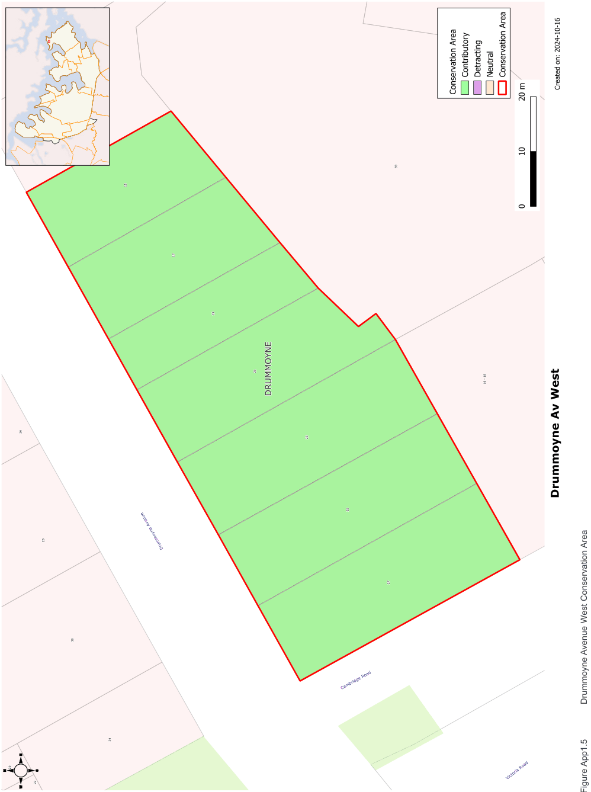

### CA.5  Drummoyne Avenue West Conservation Area

#### History

The subdivision of Drummoyne House in 1894 created suburban allotments at Wrights Point. The land around and including Drummoyne House was re-subdivided in 1907 and housing was built facing the water and with its back to Drummoyne House. The present housing at 15-27 Drummoyne Avenue is an intact part of that prestigious sub-division. It is an important element in the streetscape and the continuous character of Drummoyne Avenue.

#### Description

This group of housing is from the Federation and Inter- War periods. The group has single storey fronts with high sub-floor spaces taking advantage of the slope of the sites. The four properties at the west end of this group date from the 1907 subdivision. The next house is Post World War II and the last two houses are very fine Inter-war houses with high quality detailing.

#### Statement of Significance

This group demonstrates the sub-division of one of the major Drummoyne estates and is representative of the prevalent form of housing built in east Drummoyne reflecting the importance of the area. This is a remnant of the once contiguous Federation character of the area.

#### Objectives

Retain the Federation and Inter-War character of this group and their garden settings.

Additions should be controlled to conserve the streetscape contribution of the group.

#### Analysis - Setting

The setting of these houses is elevated from Drummoyne Avenue. Low masonry retaining walls on the street boundary provide grassed terraces between the street and the house.

#### Scale

These houses are single storey with high sub-floor areas facing the street. First floor additions are possible subject to merit. These should generally incorporate the existing roof form facing the street.

#### Form

Overall bulk is generally broken up with projecting wings either under a gabled or hipped roof. Roofs of houses in this conservation area have medium pitches. Hipped and gabled forms are used on the earlier houses with more simple hipped forms on later houses.

#### Siting

Houses are set back from Drummoyne Avenue to take advantage of the elevated part of the site.

#### Materials and Colours

Roofs are either terracotta or glazed roof tiles or slate. Walls are generally face brickwork in red or dark colours. The sub-floor is usually of sandstone or brick.

#### Doors and Windows

Generally timber framed with pairs or groups of casement and double hung sashes.

#### Carparking

Garages in this conservation area were originally located to the rear of the site and this pattern continues for the majority of sites in this conservation area.

#### Fencing

Low masonry retaining walls on the street boundary

Garden Elements including Paving and

#### Driveways

Grassed terraces between the street boundary and the house with low shrubs. Mature trees are placed to minimise interference with the views. Driveways are usually single width running past the house.

#### Refer to Figure App1.5

Development Control Plan

Appendix 1 Conservation Areas

> [Picture on page 15: a picture, saved as a picture (images/appendix-01-conservation-areas-page-15-3.gif, 150 dpi).]

Figure App1.5

Drummoyne Avenue West Conservation Area
