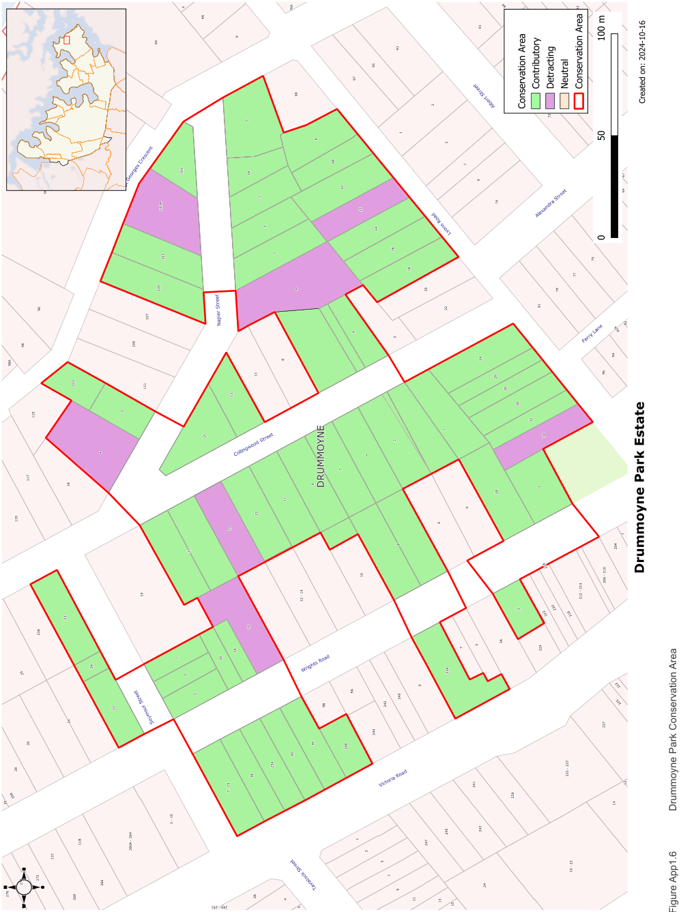
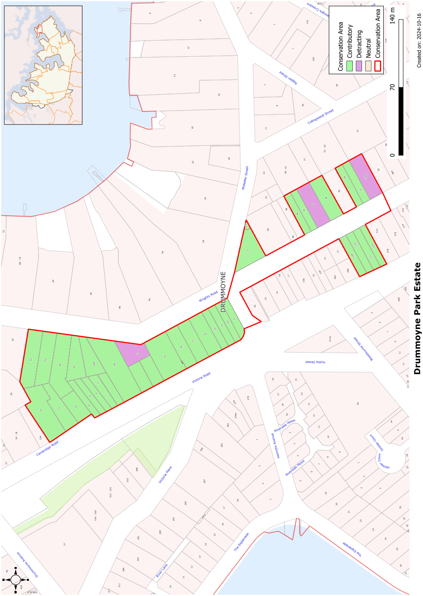

### CA.6  Drummoyne Park Conservation Area

#### History

The land on the eastern side of the present Victoria Road, north of Lyons Road, was subdivided in 1881-2 as Drummoyne Park Estate. Subsequent development included a number of substantial and well detailed Victorian Italianate houses followed by large Federation Arts and Crafts and Federation Queen Anne style housing. Much of the earlier housing was located on sites where elevated land provided good views of the harbour. This late nineteenth century development was reinforced by smaller Federation and Inter-War housing both on the original allotments of the Drummoyne Park Estate and on the subsequent subdivisions of the larger landholdings in the area.

#### Statement of Significance

The Drummoyne Park Estate Conservation Area, developed from 1881, includes substantial late nineteenth century homes in prestigious locations, such as nos. 2, 8 and 45 Wrights Road and 5-11 and 23 Collingwood Street, interspersed among smaller early twentieth century housing.  The smaller scale of the early twentieth century housing gives the Conservation Area an underlying consistency of scale, materials and form that highlights the larger houses of the late nineteenth century in the streetscape. Apart from the heritage items within the area most of the buildings and features within this precinct are of high local heritage value and a combination of representative and rare examples of their period and style in the Drummoyne context.

#### Analysis - Setting

Larger late nineteenth century houses have prominence in the streetscape. The surrounding streetscape is dominated by smaller scaled Federation period housing.

#### Scale

Two to three storey houses occupy larger sites and usually have a garden setting. On smaller sites, single storey houses dominate. Some semi-detached housing utilising double allotments is included in the area and gives the impression of larger scaled housing.

#### Form

Most of the housing that contributes to the heritage character of this Conservation Areas has prominent roof forms with terracotta being the dominant material followed by slate shingles. Facades usually include verandahs and elements that step forward of the main part of the building. This often adds interest to the roof form as well as the street front of the house. Many of the late Victorian houses incorporate bay windows.

#### Siting

Most groups of houses in this conservation area have regular setbacks from the front and side boundaries. Deeper setbacks on one side of many allotments has allowed for side driveways and provides space between houses. The earlier houses in the Drummoyne Park Estate sometimes have deeper setbacks relating to the larger scale of the buildings and the larger sites.

#### Materials and Colours

The majority of housing in the Conservation Area has face brick walling with render or cement sheeting used as a contrast. Rendered walls are restricted to the large Victorian homes in this Conservation Area.

#### Doors and Windows

Doors and windows are usually vertically proportioned. Wider openings, when they occur, are divided vertically.

#### Carparking

Parking is generally at the rear of the property, in some cases taking advantage of rear street access. On steeply sloping sites some garages have been built into the retaining walls on the street front.

#### Fencing

A mixture of fencing is used and depends to some extent on the nature of the site and the character of the house. Masonry retaining walls of face brick or stone are used on sloping sites. Low masonry fences of either face brick or stone are common on the early twentieth century development. On larger houses this might support a higher wrought steel fence. On many late Federation and Inter-War houses, the brick piers are linked by a pipe rail.

Landscape Elements including Paving and

#### Driveways

Terraced gardens provide a setting on steeply sloping sites where houses are located on the high point to maximise views. Hedges are often used where increased privacy is desired. Driveways are often a pair of concrete strips parallel to the side boundary of the house.

#### Refer to Figure App1.6 and Figure App1.7

Development Control Plan

Appendix 1 Conservation Areas

> [Picture on page 17: a picture, saved as a picture (images/appendix-01-conservation-areas-page-17-3.gif, 150 dpi).]

Figure App1.6

Drummoyne Park Conservation Area

Development Control Plan

Appendix 1 Conservation Areas

> [Picture on page 18: a picture, saved as a picture (images/appendix-01-conservation-areas-page-18-3.gif, 150 dpi).]

Figure App1.7

Drummoyne Park Conservation Area - Sheet 1
