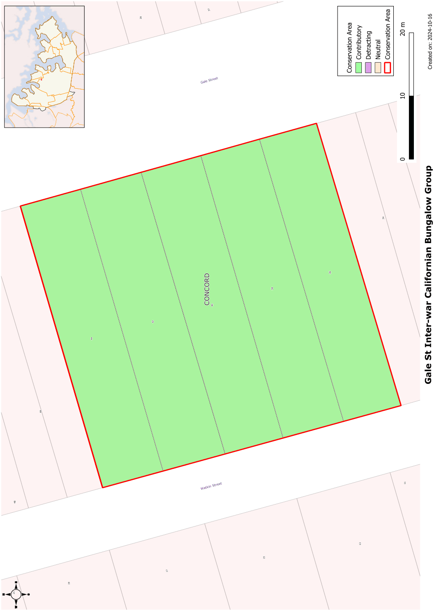

### CA.7  Gale Street Inter-War Californian Bungalow Group

#### History

Mortlake township began with the establishment of the Australian Gas Light Company’s works at Mortlake in

1886\. Subdivision of the township took place in the following two years. The group of houses at 36-44 Gale Street were built in the 1920’s and appear to have been a speculative development.

#### Description

The Gale Street Conservation area is a group of five Inter War Californian bungalows all designed to the same pattern with double gable to the front and an inset verandah. The houses have gardens to the front with low brick walls to the street. Most have been altered to some extent.

#### Statement of Significance

The Gale Street Conservation area is a good example row of five Inter-War Californian style bungalows that form an important group in the streetscape and that have historical associations with the AGL gasworks and the development of the Mortlake Township.

#### Analysis - Setting

The group is set on identical blocks along a tree lined street with rear lane access to garages and carports. The adjoining scale is predominantly single storey with a mix of Victorian and Federation cottages with some later infill development.

#### Scale

All the houses in the group are single storey with no second floor additions. There is some later two storey development close by.

#### Form

The group is in the classic Californian bungalow style in dark face brick with double gables, low pitched roofs and low, brick verandahs to the front.

#### Siting

The front setbacks are the same with a small garden to the front. The setback of adjoining houses varies.

#### Materials and Colours

The houses are predominantly in red face brick with terracotta tile roofs and painted timber casement windows. Some of the verandahs have been infilled and external walls rendered.

#### Car Parking

The rear lanes provide car access to garages and carports.

#### Fencing

The front fencing is not consistent, with a mix of low masonry walls, timber pickets of various styles and metal palisade fencing.

Landscape Elements including Paving and

#### Driveways

Front gardens are dominated by lawns with perimeter shrub planting with some hedging. There are some street trees with Paperbarks predominant.

#### Refer to Figure App1.8

Development Control Plan

Appendix 1 Conservation Areas

> [Picture on page 20: a picture, saved as a picture (images/appendix-01-conservation-areas-page-20-3.gif, 150 dpi).]

Figure App1.8

Gale Street Inter-War Californian Bungalow Group
