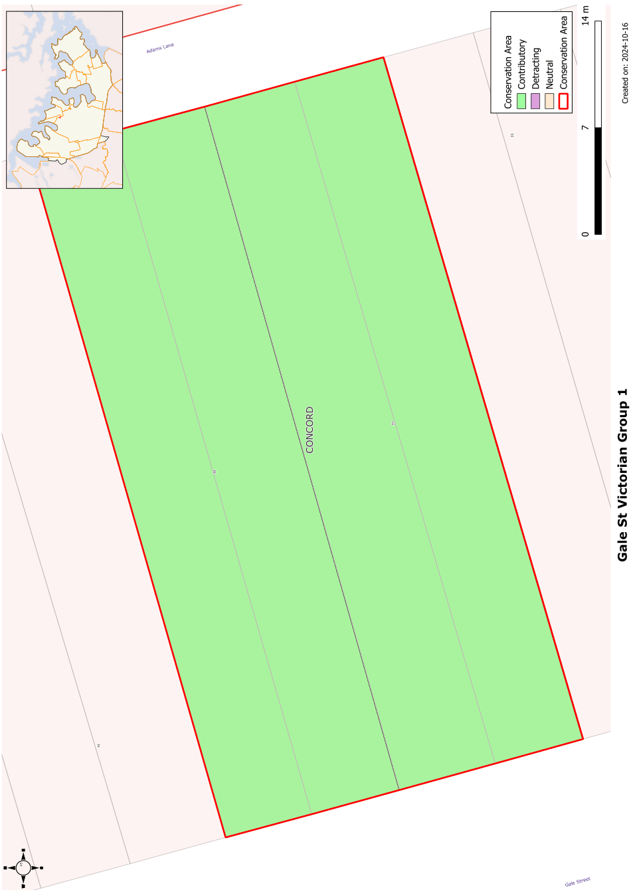

### CA.8  Gale Street Victorian Housing Group

#### History

Mortlake township began with the establishment of the Australian Gas Light Company’s works at Mortlake in

1886\. Subdivision of the township took place in the following 2 years. The houses at 37-39 Gale Street were built soon after the subdivision of the township.

#### Description

The Gale Street Conservation area is a group of two, single storey, Victorian cottages with symmetrical front verandahs.

#### Statement of Significance

The Gale Street Conservation area is a good example of two Victorian cottages that form an important group in the streetscape that have historical associations with the AGL gasworks and the subdivision of the Mortlake Township.

#### Analysis - Setting

The group is set on similar blocks along a tree lined street with rear lane access to garages and carports. The adjoining scale is predominantly single storey with a mix of Victorian and Federation cottages with some later infill development.

#### Scale

The houses are single storey with no second floor additions. There is some later two storey development close by.

#### Form

The group is in the Victorian cottage form style with double fronted elevations and front verandahs

#### Siting

The front setbacks are the same with a small garden to the front. The setback of adjoining houses varies.

#### Materials and Colours

The houses are in different materials. 37 Gale Street is in painted brick with high gables to the side and has a bullnosed verandah with a corrugated metal roof. 39 Gale Street is in weatherboard with a concrete tile roof.

#### Car Parking

The rear lane provides car access to rear garages and carports.

#### Fencing

The front fencing varies with a metal tube and wire fence to 39 Gale Street and no fence to 37 Gale Street.

Landscape Elements including Paving and

#### Driveways

The small front gardens are laid to lawn with some shrub planting.

#### Refer to Figure App1.9

Development Control Plan

Appendix 1 Conservation Areas

> [Picture on page 22: a picture, saved as a picture (images/appendix-01-conservation-areas-page-22-3.gif, 150 dpi).]

Figure App1.9

Gale Street Victorian Housing Group
