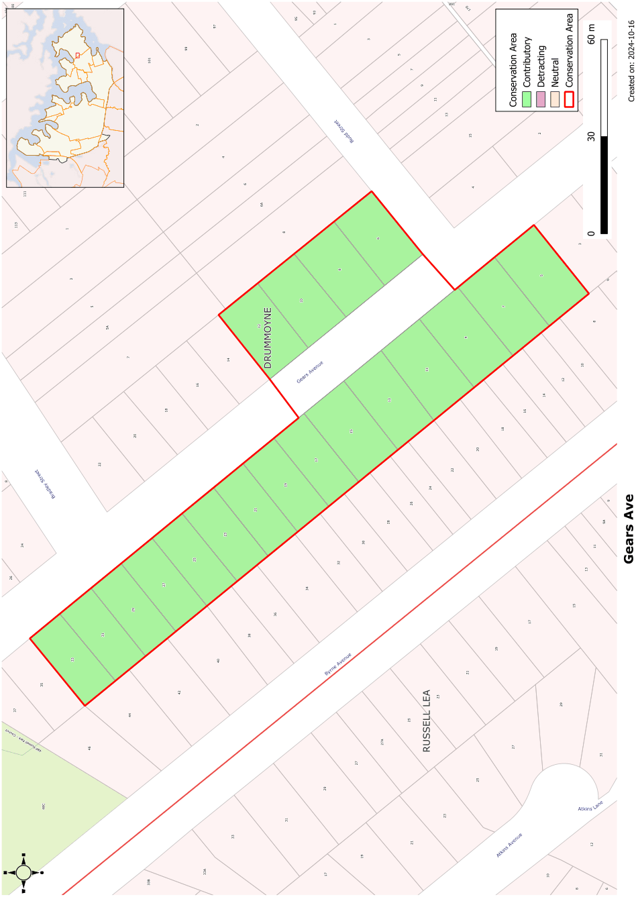

### CA.9  Gears Avenue Conservation Area

#### Form

#### History

The front of the houses are generally broken down with a verandah section and a projecting room with a gabled or hipped roof. The repetition of gables and hipped forms is an important part of the streetscape. The verandahs have low horizontal proportions with heavy masonry piers.

Gears Garden Estate was subdivided in 1924 creating lots generally with 50 foot frontages to Gears Avenue. The present 17-35 Gears Avenue were re-subdivided in 1926 to create allotments with 40 foot frontages. The housing in the Gears Avenue Conservation Area all appear to have been built in a short period following the subdivisions.

#### Siting

#### Description

The houses in this group have regular setbacks from the street boundary. A deeper setback on one side boundary of most houses provides space between houses and vehicular access to the rear of the site.

This group of Inter-war houses is an intact group of predominantly bungalow influenced houses with one very good example of the Californian Bungalow style set high up on the rise and well above the street.

#### Materials and Colours

#### Statement of Significance

Walls are generally of face brickwork with use of battened fibro on gables as a contrasting element. The roofs are typically glazed tiles.

#### Doors and Windows

Timber casements in pairs or groups of three or double hung windows in pairs.

#### Carparking

The Gears Avenue, Drummoyne Conservation Area is a very good example of housing from the Inter-War period and has survived intact with setting, fences and detailing. The vista down the hill towards the water typifies the development of Drummoyne with Lyons Road on the ridge and streets falling towards the water. The regular division of the allotments, consistency of materials and scale of the housing combines with the slope of the land to create an attractive streetscape.

Single driveways with garages or carports located well behind the building line.

#### Objectives

#### Fencing

Many original fences have survived in this conservation

area. They are typically low street fences with brick piers and panels sometimes using pipe rails between piers.

Original details of houses should be retained with fencing and garden settings to enhance the character of the street. Additions should reflect the character of the existing buildings in order to retain the streetscape and heritage value of the streetscape. Garages and carports should not be added in front of the building line.

#### Analysis - Setting

Landscape Elements including Paving and

#### Driveways

Housing has a consistent setback behind low street fencing and gardens. One side of each allotment has a greater setback to allow a driveway to go to the rear yard.

Single driveways with concrete driving strips typically run along the side boundary past the house. Gardens to these houses often include a curved path to the front door and hedge type plants behind the front fence.

#### Scale

#### Subdivision

The housing in Gears Avenue is mainly single storey facing the street.

This conservation area has a regular subdivision pattern of 40 and 50 feet frontages (12.192m and 15.25m).

#### Refer to Figure App1.10

Development Control Plan

Appendix 1 Conservation Areas

> [Picture on page 24: a picture, saved as a picture (images/appendix-01-conservation-areas-page-24-3.gif, 150 dpi).]

Figure App1.10

Gears Avenue Conservation Area
